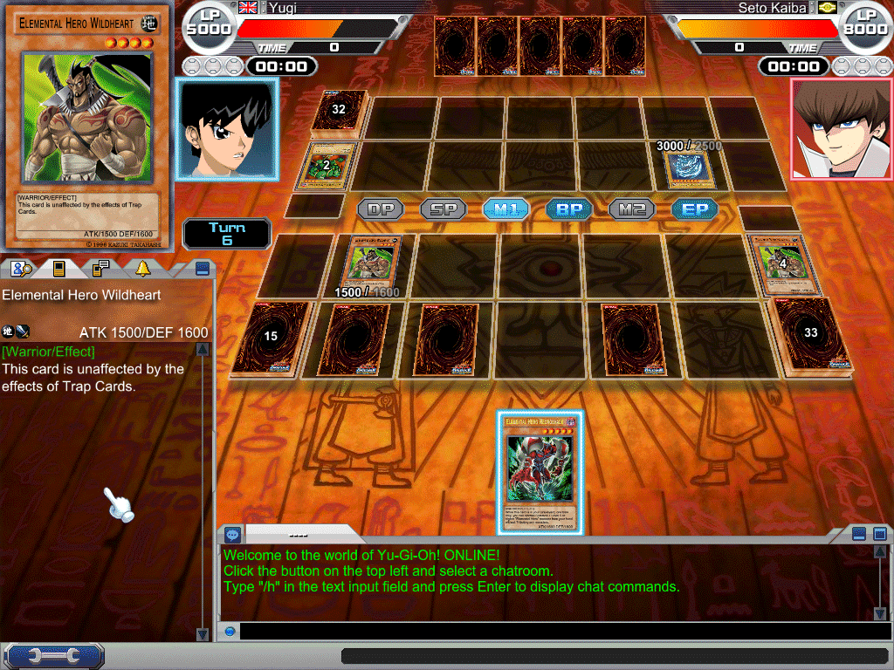
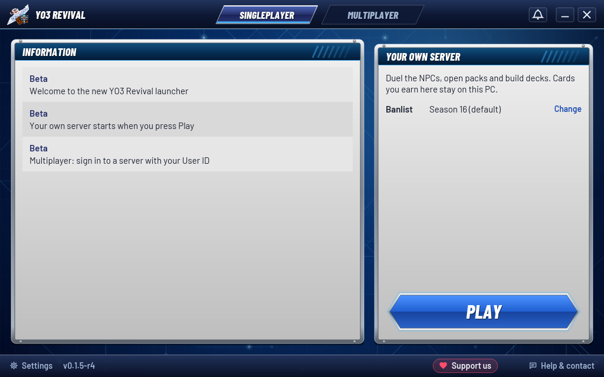
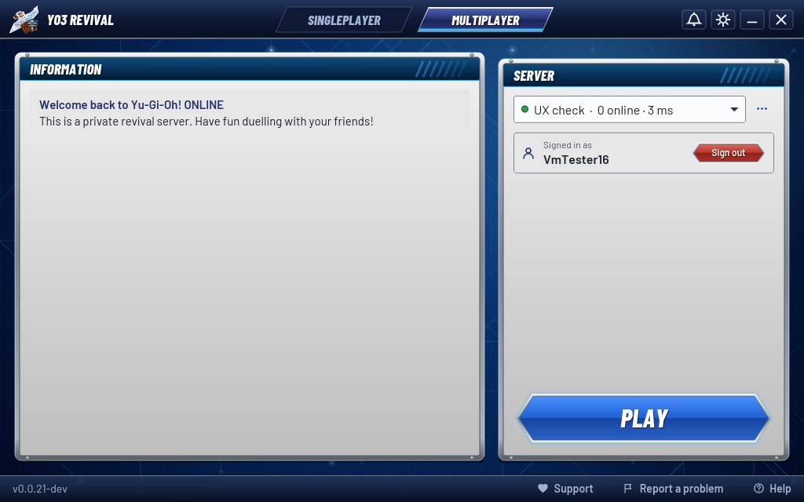
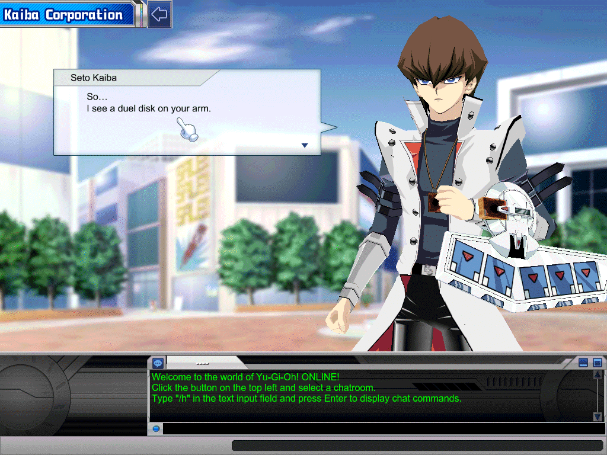
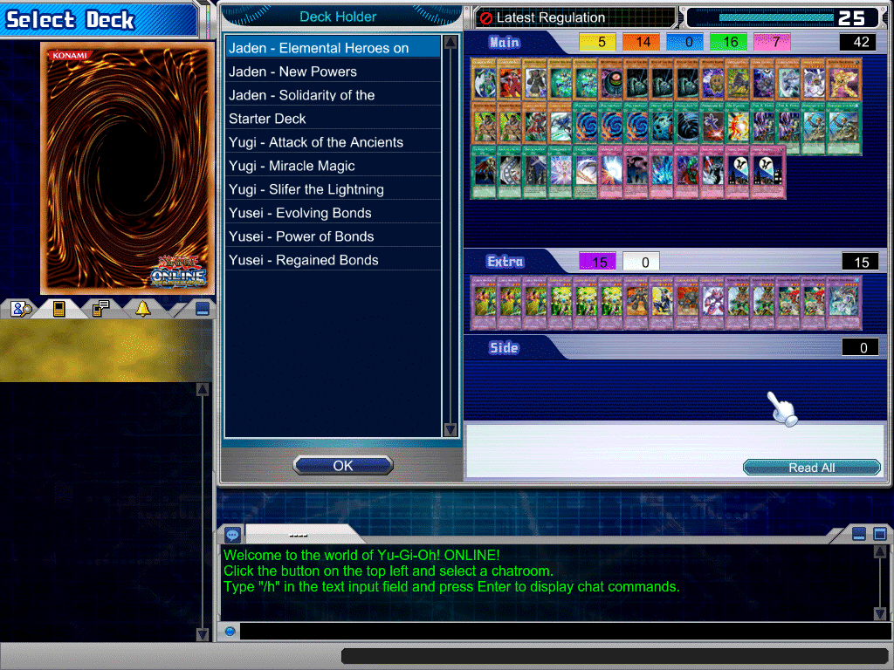

# YO3 Revival

A private server and launcher for the retired **Yu-Gi-Oh! ONLINE 3 (Duel Accelerator)**. Duel the computer on your
own PC, or play with others on our server or a friend's, using the original game client.

## Start playing

You need the original game **v1.153**, installed separately: Revival does not include it
([where to get it](docs/launcher.md#getting-the-original-game)). It runs on **64-bit Windows 10/11** or **Linux with
Wine**. Windows 7 is not supported ([at your own risk](docs/launcher.md#windows-7)).

1. [Download the latest release](https://github.com/usersina/yo3-revival/releases/latest): **Desktop** for your
   system. Extract the whole archive and open **`yo3-revival`** (`.exe` on Windows) in `yo3-revival-desktop/`.
2. **Setup** finds your game folder and checks it. Click **Done**.
3. Click **PLAY**, choose **ONLINE** in the game, then your player. Your starting deck is ready.

| Singleplayer: your own server, one click                          | Multiplayer: our server is listed already                         |
| ----------------------------------------------------------------- | ----------------------------------------------------------------- |
|      |  |

**Singleplayer** needs no account: visit **Kaiba Corporation** on the map for your first duel
([playing guide](docs/playing.md)). For **Multiplayer**, pick our server or add a friend's with their invite link,
then create an account with an invite code and sign in ([joining a server](docs/launcher.md#join-another-server)).

| Duel against Kaiba                                             | Build your deck                                                                            |
| -------------------------------------------------------------- | ------------------------------------------------------------------------------------------ |
|  |  |

Antivirus warning? [Check the download and what to allow](docs/antivirus.md). Something else wrong?
[Troubleshooting](docs/launcher.md#troubleshooting).

## Host a server

- **For friends, from the launcher:** **Host for friends** on the Multiplayer tab gives you an invite link per friend
  ([hosting guide](docs/launcher.md#host-friends)).
- **On a Linux VPS:** [one-time setup](docs/deployment.md), or [Docker Compose with HTTPS](docs/docker.md).
- **From a terminal:** the Scripts edition ([terminal setup](docs/scripts.md#host-friends),
  [commands](docs/guide.md)).

## Help and more

This is a beta: **Report a problem** (the launcher footer's **Help**) includes your logs
([reporting guide](docs/launcher.md#logs-and-support)) · [Issues](https://github.com/usersina/yo3-revival/issues/new/choose)
· [Discussions](https://github.com/usersina/yo3-revival/discussions) · [Features](docs/playing.md#features-and-limitations)
and [their status](docs/features.md) · [All documentation](docs/README.md)

**Developers:** the server is written in Rust, reverse-engineered from the game client, and runs duels on
[EDOPro](https://github.com/edo9300/edopro)'s rules engine. Start with [docs/](docs/README.md) and
[AGENTS.md](https://github.com/usersina/yo3-revival/blob/main/AGENTS.md).

[MIT](LICENSE) · [Project, credits and support](docs/about.md) · [Code signing policy](docs/code-signing.md) ·
Unaffiliated with Konami.

If you'd like to support the work: [donatr.ee](https://donatr.ee/usersina/) · BTC
`bc1qawq699ewyq0vgyux6nmyyx29r4vhj573l77elj`
