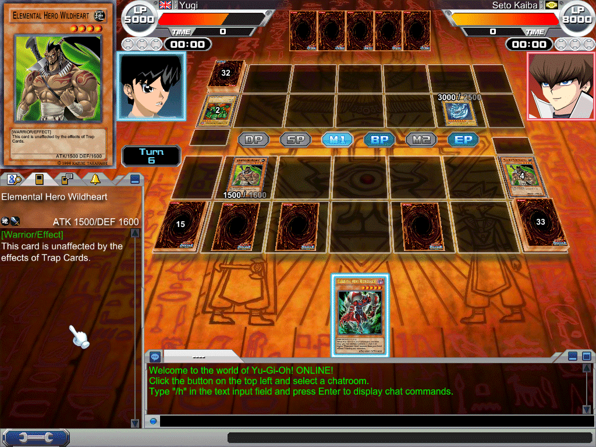
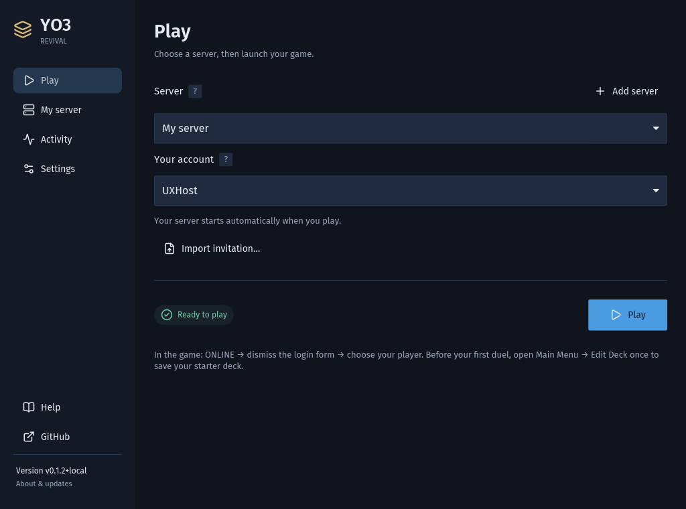
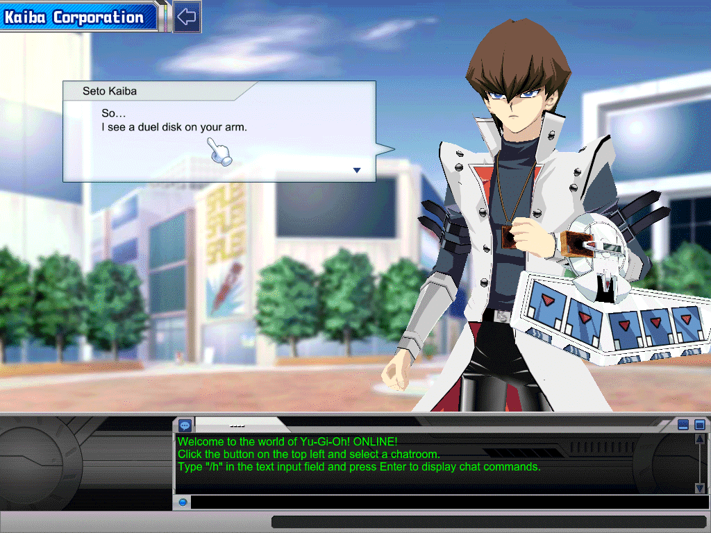
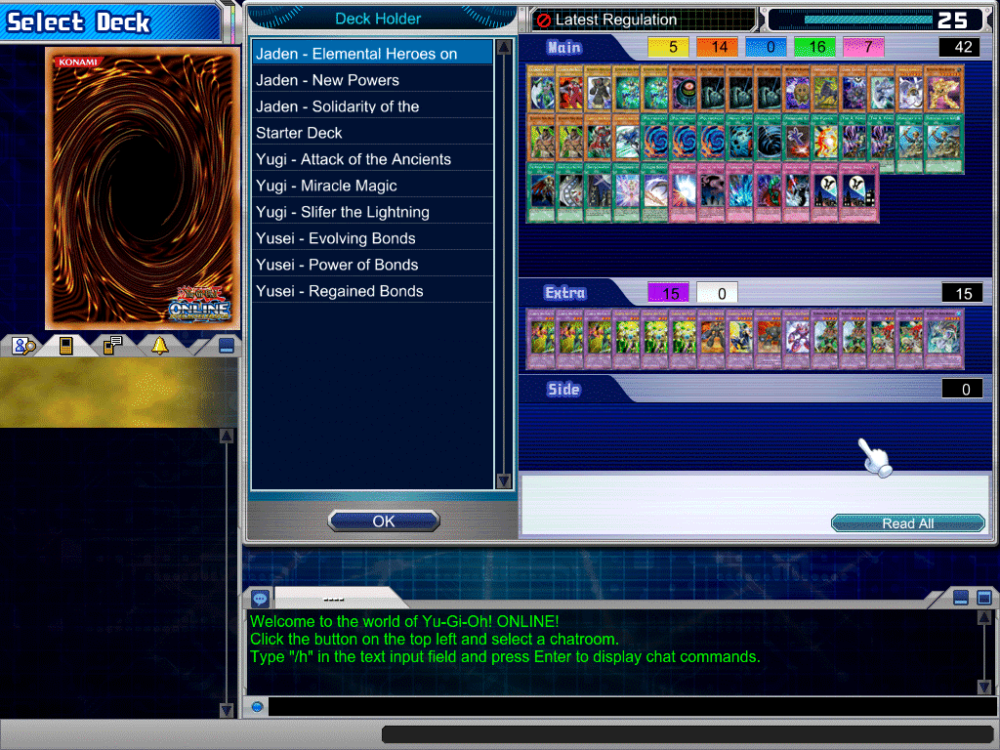

# yo3-revival

A private server for **Yu-Gi-Oh! ONLINE 3 (Duel Accelerator)**, Konami's online card game that shut down in 2012. Log
in through the authenticated revival launcher and duel again: against the computer, or with your friends.

  

  The original game client (ver. 1.153), mid-duel on this server (screenshot of Konami's game).

## Start here

There is no public server. You can host on your own PC or join a friend's server. Everyone needs their own install
of the original game **ver. 1.153**; Linux players also need Wine. Game files are not included.

**Open `yo3-revival.exe` (Windows) or `yo3-revival` (Linux)** from an extracted current bundle. The application
combines playing, connections, server controls and logs in one window. In **Settings**, choose your game folder.
Published releases through v0.0.3 predate this application; until a new release is published, a developer must
[build the current bundles](docs/guide.md#run-from-source).

- **Joining a friend?** Import their private invitation on **Play**, save the connection and press **Play**.
  You can also discover their address, approve their identity and enter the account key they supplied.
- **Hosting friends?** Set your reachable address in **My server → Advanced**, then **Start server** in **Overview**.
  New servers listen on all IPv4 interfaces; **My server → Advanced** selects a specific interface or port.
  Create accounts and private invitations on **My server → Players & invitations**, and allow the chosen TCP port through the firewall.
- **Playing alone?** Choose **My server** on **Play** and press **Play**; your server starts automatically.

The [graphical setup guide](docs/launcher.md) walks through all three paths, certificates, data and troubleshooting.
You can keep hosting your server while joining another, and leave hosting running when you close the application.
**Settings → Advanced game options → Enable direct launch** optionally sets up the original game executable/shortcut to use your saved
connection too, with component and server checks before login.

Authentication happens in the launcher; the game's original username/password fields are unused. The game executable
and `yo3.ini` stay unchanged. Each account has its own access key, so friends sharing a router stay separate.

The sidebar shows the current version and links to GitHub. Updates are checked automatically at startup;
**About & updates → Review & install** downloads and installs a verified update after your confirmation.
See [application updates](docs/launcher.md#application-updates) for restart and data details.

## Your first duel

1. Choose your connection on **Play**, then press **Play**.
2. Press **ONLINE**, dismiss the original login form and select your player.
3. Open **Main Menu → Edit Deck** once, then leave it to save your starting decks.
4. Visit **Kaiba Corporation** for a computer opponent. With a friend, both choose **Auto Duel → Confirm**, or use
   **Create Duel** to arrange a specific match.

The [command-line guide](docs/guide.md) remains available for terminal users and source builds.

## Something wrong?

Check [Troubleshooting](docs/launcher.md#troubleshooting) first. Still stuck, or found a bug?
[Open an issue](https://github.com/usersina/yo3-revival/issues/new/choose) and attach a diagnostic ZIP from
**Activity → Export logs** (choose **Current session** or **All retained sessions**). Review it before sharing;
private invitations, account keys and databases do not belong in bug reports. Nothing is uploaded automatically.

## What works

Duels against the computer and between players (Auto Duel, Create Duel, Match Mode, spectating) with the real card
rules, the official Yugi, Jaden and Yusei decks, Edit Deck, the shop and booster packs, trades, chat, friends, D-Mail,
teams and tournaments. The full list, and what is left, is in [the guide](docs/guide.md#what-works-and-what-doesnt-yet)
and the [roadmap](docs/roadmap.md).

| Duel against Kaiba                                                  | Official character decks                                                    |
| ------------------------------------------------------------------- | --------------------------------------------------------------------------- |
|  |  |

## For developers

The server is written in Rust, reverse-engineered from the game client, and runs duels on
[EDOPro](https://github.com/edo9300/edopro)'s rules engine. Everything technical (building from source, the protocol,
the client's internals, the roadmap) is in [docs/](docs/README.md). To contribute, read [AGENTS.md](AGENTS.md) first.

## Legal

This is a non-commercial fan preservation project. It is **not affiliated with or endorsed by Konami**. Yu-Gi-Oh!
and Yu-Gi-Oh! ONLINE 3 belong to Konami; so do the cards, art and the game client. The game screenshots above show
Konami's game; the launcher screenshot shows our application. This repository holds original code and notes: no game files, card data, art, decompiled code or
packet logs are distributed (the screenshots in `docs/images/` are the one exception, and they show the game, not its
data). You need your own copy of the client, and the server reads your install's data files at run time. The release
bundles also carry the rules engine, which is other people's open-source work (see `engine/THIRD-PARTY.md` in a
bundle).

## License

[MIT](LICENSE), covering this project's own code and documentation. It does not cover Konami's game or any of its
content.

---

If you'd like to support the work: [Buy me a coffee](https://buymeacoffee.com/usersina) · BTC
`bc1qawq699ewyq0vgyux6nmyyx29r4vhj573l77elj`
