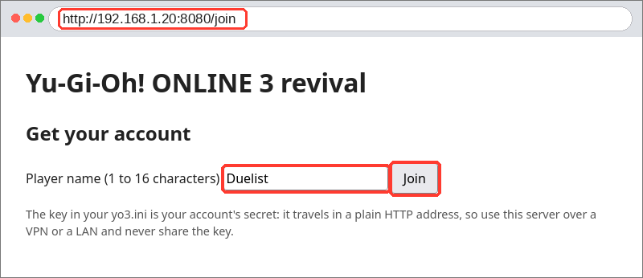
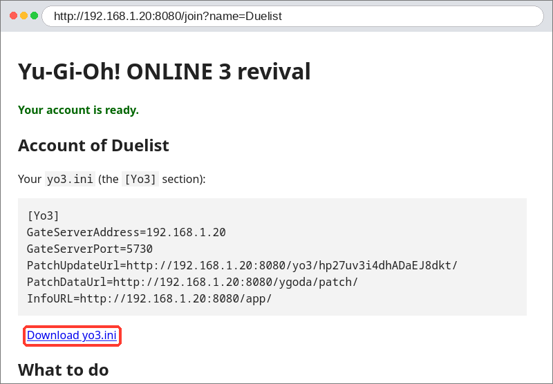
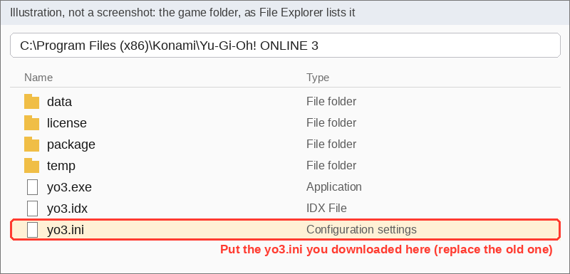
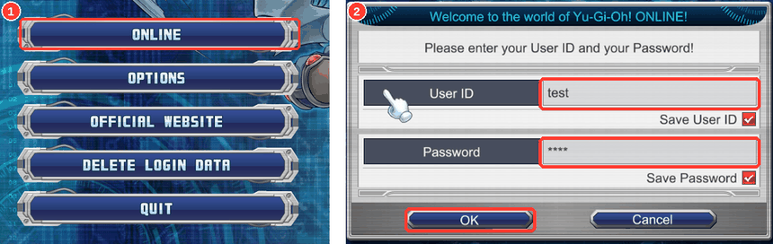
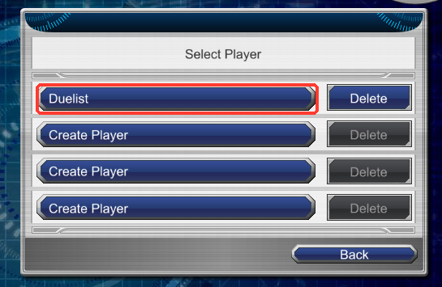
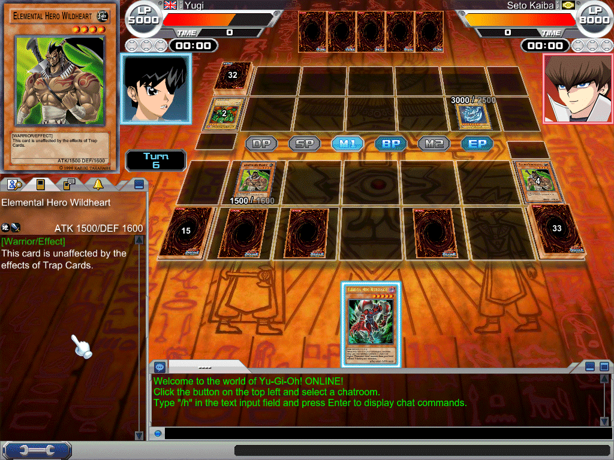

# Hosting and joining: playing Yu-Gi-Oh! ONLINE 3 with friends

One person (the host) runs the server; everyone, the host included, plays with the original game client pointed at
it. This server is unofficial and has nothing to do with Konami. It ships no game files: every player needs their own
install of the client (the last released version, ver. 1.153).

**Contents**

- [Play on your own PC](#play-on-your-own-pc)
- [For the host](#for-the-host)
  - [LAN checklist](#lan-checklist)
  - [Windows SmartScreen and antivirus warnings](#windows-smartscreen-and-antivirus-warnings)
  - [macOS](#macos)
- [For every player](#for-every-player)
  - [Joining, step by step (with pictures)](#joining-step-by-step-with-pictures)
- [What works and what doesn't yet](#what-works-and-what-doesnt-yet)
- [When something goes wrong](#when-something-goes-wrong)

## Play on your own PC

**There is no public server.** Someone has to run one, and `HOST` in this guide means that person's address. If you
only want to duel the computer opponents (or you have nobody to host), you are the host, on your own PC, and `HOST` is
`127.0.0.1`:

1. Install the game (ver. 1.153; see [For every player](#for-every-player) for where to find the installer).
2. Download the bundle for your system from the [latest release](https://github.com/usersina/yo3-revival/releases/latest)
   (Linux `.tar.gz`, Windows `.zip`) and unpack it anywhere. It has everything, the duel rules included: nothing else
   to install.
3. Run `run.cmd` (Windows) or `./run.sh` (Linux). It leaves a window open: keep it open while you play.
4. Open **<http://127.0.0.1:8080/join>** in a browser on the same PC, type a player name, press **Join**, press
   **Download yo3.ini** and put that file in the game's install folder (`C:\Program Files (x86)\Konami\Yu-Gi-Oh! ONLINE 3`),
   replacing the original (keep a copy). The file that comes with the game points at Konami's servers, which are gone,
   so it must be replaced; the downloaded one points at your own PC.

Then start the game, press **ONLINE**, log in with any name and password, pick your player, open **Main Menu → Edit
Deck** once (it saves your starter deck), and walk the map to **Kaiba Corporation** for a computer opponent. Every
step above and below has a picture in [Joining, step by step](#joining-step-by-step-with-pictures).

## For the host

You need Linux or Windows and the game installed (the server reads its card data from your install). The release
bundle carries the rest: the rules engine (EDOPro's core, ProjectIgnis' card scripts and card database) with its own
Node.js, in `engine/` (what each part is and its license: `engine/THIRD-PARTY.md`). Nothing to install.

1. Unpack the [release](https://github.com/usersina/yo3-revival/releases/latest) for your system (or build both with
   `tools/release.sh`) and start it: `./run.sh` on Linux, `run.cmd` on Windows (double-click it, or run it in a
   terminal to pass options). Your game install is found in
   `~/.wine/drive_c/Program Files (x86)/Konami/Yu-Gi-Oh! ONLINE 3` on Linux and `C:\Program Files
   (x86)\Konami\Yu-Gi-Oh! ONLINE 3` on Windows; pass `--game-dir DIR` otherwise.
2. Make the server reachable. Friends connect to TCP ports **5730** (gate), **1213** (front), **1214** (duels) and
   **8080** (patch check):
   - **Same network:** friends use your LAN address (`ip -4 addr`, or `ipconfig` on Windows, e.g. `192.168.1.2`).
     Open the ports if a firewall runs: `sudo ufw allow 5730,1213,1214,8080/tcp`, for firewalld `sudo firewall-cmd
     --add-port={5730,1213,1214,8080}/tcp`, and on Windows allow `yo3-server.exe` when Windows asks, or in an
     administrator terminal `netsh advfirewall firewall add rule name="yo3-revival" dir=in action=allow protocol=TCP
     localport=5730,1213,1214,8080`.
   - **Over the internet, easiest:** a mesh VPN (Tailscale, ZeroTier, NetBird). Everyone joins your network and uses
     your VPN address (e.g. `100.x.y.z`). Nothing to forward, and only your friends can reach the server.
   - **Over the internet with port forwarding:** forward the four ports on your router to your machine, and start the
     server with your public address or DNS name: `./run.sh --advertise my.name.example`.

   The server sends each client to the address it used to reach the server, so one server answers on all of these at
   once. `--advertise` is only needed when the address clients dial isn't one of the machine's own (port forwarding).

   By default there is no banlist (any card, up to 3 copies each). To use one, start the server with
   `--regulation`, e.g. `./run.sh --regulation "Season 16"`, `"OCG 2006-09-01"` or `1` (the game's first list); an
   unknown name lists them all. Auto Duel and Kaiba Corporation check decks against it; it shows as "Latest
   Regulation" in Create Duel, where a host can still pick another (Create Duel → Customize → Regulations → Select).
3. Share the join page. Friends make their own account at **`http://HOST:8080/join`** (HOST is the address they reach
   you at: your LAN or VPN address, or your public name; tell them to type that address, not the word "HOST"). Nothing else to run, and the server can stay up. The game
   never sends a name or password, so an account is found by a secret **key** that rides in the friend's
   `PatchUpdateUrl` (the game fetches that address before every login); the page makes the account (one player with
   the name the friend picks, the starter deck, the starting BP), shows the friend their five `yo3.ini` lines (the host
   in them is the address the friend typed, from the request's `Host` header) and a download of a ready `yo3.ini`.
   Whoever has the key can play as that friend, and it travels in a plain HTTP address, so use the page over a VPN or
   a LAN. **On a server reachable from the internet start it with `--no-join`** (`./run.sh --no-join`): `/join` then
   answers 404 and you make accounts by hand, below.

   Limits: a friend's address gets its account back when it visits `/join` again (its key and lines are shown again),
   may make up to four accounts (a second name, for a second person behind the same router), and the page makes at
   most 20 accounts per hour in all. A friend who already played here without a key (an account found by their
   address alone) sees a "Keep my account" button: it gives that account a key, so nothing is lost. Players can also
   be made by the friends themselves at Select Player (an empty slot says "Create Player": a name, then the avatar) and
   deleted (Delete; the password it asks for can be anything).

   **By hand instead**, for hosts who prefer it (or with `--no-join`), with the server stopped:

   ```sh
   ./yo3-server add-account Anis --advertise 100.64.0.5   # Anis's account, first player "Anis"; --also Alt,Spare adds more
   ```

   It prints the key and the `yo3.ini` lines to send Anis (`--advertise` is the address friends reach you at; without it
   the lines say `HOST`, which you replace). Friends behind the same router each get their own account.

   ```sh
   ./yo3-server accounts                     # who's who: address, key, players
   ./yo3-server add-player Anis Spare        # another player for Anis's account (an address works too)
   ./yo3-server rename Duelist2 Joey         # rename a player
   ./yo3-server key Anis --advertise 100.64.0.5   # print an account's key and lines again (by a player's name or address)
   ```

   On Windows it is `yo3-server.exe add-account ...` and so on, in a terminal in the server's folder.

   **Without a key** (a `yo3.ini` that points at the server with no key in `PatchUpdateUrl`), the server falls back to
   one account per address, made on first contact with a player called "Duelist" (then "Duelist2", "Duelist3"...). A
   VPN gives each friend their own address; friends behind one router share that account. If such a friend's address
   changes they arrive as a new, empty account; either give them a key for their old account
   (`./yo3-server key 100.64.0.7` prints it, nothing is lost), or move the old one to the new address, with the
   server stopped (players, cards, BP, decks and records go along):

   ```sh
   ./yo3-server move-account 100.64.0.7 100.64.0.9            # the old address, then the new one
   ./yo3-server move-account 100.64.0.7 100.64.0.9 --replace  # if they already connected from the new address
   ```

   Without `--replace` the server refuses to overwrite the account it made at the new address, and names its players
   (`--replace` discards that one, so check it's the empty newcomer).

   A key counts for the login that follows the game's start: it is looked up when the game fetches the patch address,
   remembered for that source address for 10 minutes (each login renews it), and the most recent fetch from an address
   wins. Two friends behind one router who start the game in the same moment can therefore swap accounts; start one
   after the other. The key shows up in the server's log lines as `presented an account key`, and an unknown key as
   a warning (that login then goes to the address account).

   The flag next to a player's name (Player Information, player search, the tournament bracket) is a setting of the
   account, because the game never tells the server where its player lives. Left alone it follows the game's language
   (English shows the UK flag, Japanese Japan, and so on); to give a friend's account another one:

   ```sh
   ./yo3-server countries                    # the codes the game has flags for (FR, JP, US, TN...)
   ./yo3-server set-country Anis TN          # that account's players show the Tunisian flag (a player's name or an address)
   ./yo3-server set-country Anis auto        # back to following the game's language
   ```
4. Accounts and win/loss records live in `data/` (`accounts.json`, `records.json`), backed up into `data/backups/` at
   every start (the last 10 are kept). Back up `data/` to keep them.

### LAN checklist

Friends on the same network cannot connect? Go through this in order, before anyone starts the game:

1. **Find your address.** Windows: open a terminal and run `ipconfig`, and read the *IPv4 Address* of the adapter
   that is connected to your router (for example `192.168.1.23`). Linux: `ip addr` (or `ip -4 addr`) and the
   `inet` address of your Wi-Fi or Ethernet. Give friends that address, and they use it as `HOST`.
2. **Allow the server through the firewall.** Windows Defender Firewall asks the first time `yo3-server.exe` runs:
   tick **Private networks** and press **Allow access**. If you pressed Cancel, Windows blocked it and LAN friends
   cannot connect (you can, from the same PC). Fix it in Windows Security → Firewall & network protection → *Allow
   an app through firewall* → *Change settings* → find `yo3-server` (or *Allow another app*) and tick Private; or in an
   administrator terminal: `netsh advfirewall firewall add rule name="yo3-revival" dir=in action=allow protocol=TCP
   localport=5730,1213,1214,8080`. On Linux: `sudo ufw allow 5730,1213,1214,8080/tcp`, or for firewalld `sudo
   firewall-cmd --add-port={5730,1213,1214,8080}/tcp`.
3. **Test from the friend's PC before starting the game:** the friend opens `http://HOST-IP:8080/join` (your address
   from step 1) in a browser. The join page appearing means the network and firewall are fine. A page that keeps
   loading means a firewall or the wrong address.
4. **Beware of the wrong network interface.** If you run a VPN, a virtual machine or WSL, `ipconfig` lists several
   adapters, and one of them is not the one your friends can reach. Spot it by the step 3 test failing while
   everything else is right, or by the address not matching your router's range (a home LAN is usually `192.168.x.x`
   or `10.x.x.x`). Try the other addresses in the list, or switch the VPN off while testing.

### Windows SmartScreen and antivirus warnings

`yo3-server.exe` is not code-signed (a signing certificate costs money a hobby project does not have), so Windows
SmartScreen ("Windows protected your PC": press *More info*, then *Run anyway*) or some antivirus programs may warn
about it or quarantine it. That is expected for a new unsigned program, not proof of a virus. To check that you have
the real file, compare its SHA-256 with the one in the release notes (PowerShell: `Get-FileHash .\yo3-server.exe`),
or avoid the question and [build it yourself from the source](#run-from-source); all the code is in the repository.

### macOS

macOS is **untested**. The client is a Windows program, so it would need a Wine wrapper (for example CrossOver or
Whisky), which we have not tried. The server uses no Windows- or Linux-only code, so it should build and run on macOS
with the Rust toolchain (`cargo run --release -p yo3-server -- --bind 0.0.0.0 --game-dir "<the game's folder>"`; the
default game folder is a Windows or Wine path, so pass `--game-dir`) and Node.js 22.18 or newer with
`engine/fetch.sh` run once (the bundles' Node.js is for Linux and Windows only), but nobody has checked. Reports
welcome (see [When something goes wrong](#when-something-goes-wrong)).

### Run from source

Instead of a release bundle: the [Rust toolchain](https://rustup.rs/), and for the rules engine Node.js 22.18 or newer,
npm, Git and curl. From a clone of the repository:

```bash
engine/fetch.sh                                   # once: the engine's package, card scripts and card database
cargo run --release -p yo3-server -- --bind 0.0.0.0 --log-dir logs
```

`tools/release.sh` builds the bundles themselves (see [CLAUDE.md](../CLAUDE.md#commands)).

## For every player

### Joining, step by step (with pictures)

`HOST` is the **address of the person running the server** (the host tells you; there is no public server). The
pictures use `192.168.1.20` as an example; on your own PC it is `127.0.0.1`. The red boxes mark what to click or
type. The numbered list after the pictures has the same steps in words, with the details.

**1. Open the join page in a browser:** `http://HOST:8080/join`. Type the player name you want and press **Join**.



**2. Press Download yo3.ini.** The page also shows the file's lines; you do not have to read them.



**3. Put the downloaded `yo3.ini` in the game's folder**, replacing the one that is there (keep a copy of the old one).
The folder is `C:\Program Files (x86)\Konami\Yu-Gi-Oh! ONLINE 3` on Windows. This picture is a drawing, not a screenshot.



**4. Start the game, press ONLINE** and log in with any User ID and password (nothing checks them), then OK.



**5. Pick your player**: the name you gave on the join page.



**6. Once: open Main Menu → Edit Deck.** The Main Menu is the button at the bottom left. Edit Deck's folder icon
(top left) lists your Starter Deck and the official character decks. Opening Edit Deck saves them; leave it with the
arrow at its bottom left. Without a deck the duel button refuses.


**7. To duel, press the duel button on the bottom bar, then Auto Duel and Confirm.** When two players wait with
the same Rule Format they are matched. (To pick your friend instead, use **Create Duel**: the numbered list below says how.)


Then pick your deck and play. The computer opponents are at Kaiba Corporation on the map.



1. Install Yu-Gi-Oh! ONLINE 3. On Windows it runs as it is; on Linux it runs under Wine. The original installer (the
   2011-07-28 setup, about 900 MB) is preserved by a third party on [My Abandonware](https://www.myabandonware.com/game/yu-gi-oh-online-3-duel-accelerator-qy4); it is Konami's software,
   not part of this project, and you download it at your own discretion. Install it, then continue below (no patch
   needed: the game checks this server for updates).
2. Open the host's join page, `http://HOST:8080/join` (the host tells you HOST: it is the host's address, there is no
   public server; on your own PC it is `127.0.0.1`), type the player name you want and
   press Join. The page shows your `yo3.ini`: press **Download yo3.ini** and put the file in the install folder
   (`C:\Program Files (x86)\Konami\Yu-Gi-Oh! ONLINE 3`), replacing the one there (keep a copy of the original). Windows
   protects Program Files: copy the file in with Explorer and accept the administrator prompt, or give your user write
   permission on `yo3.ini` first. The secret in your `PatchUpdateUrl` (the part after `/yo3/`) is what makes the server
   give you your own account, wherever you connect from, so keep the file to yourself. If you lose it, open the join
   page again from the same address and it shows your lines again.

   Without the page (the host made your account, or turned the page off), paste the lines the host sent over the
   `[Yo3]` section by hand. All five lines must point at the host (here `100.64.0.5`; the host itself can use
   `127.0.0.1`): the game checks for updates at `PatchUpdateUrl` before it connects at all, and Konami's addresses are
   gone, so changing only the first line isn't enough.

   ```ini
   [Yo3]
   GateServerAddress=100.64.0.5
   GateServerPort=5730
   PatchUpdateUrl=http://100.64.0.5:8080/yo3/<your key>/
   PatchDataUrl=http://100.64.0.5:8080/ygoda/patch/
   InfoURL=http://100.64.0.5:8080/app/
   ```

3. Start the game, press ONLINE, log in with any name and password (they aren't checked), then pick your player.
4. Once: open **Main Menu → Edit Deck** and leave it again. That saves your starter deck and three official
   official character decks: Yugi's, Jaden's and Yusei's, three each (Edit Deck's folder icon loads them; if your own
   decks fill the list, the rest come the next times you open Edit Deck, on any PC). Without a deck the duel button
   says "There are no valid Decks available."
5. To duel a friend, press the duel button on the bottom bar, then either:
   - **Auto Duel → Confirm**: when two players wait for the same Rule Format they're matched;
   - **Create Duel → Confirm** (with a password if you like): your friend opens the player list (the first tab of
     the panel on the left), clicks your name, and presses **Send Duel Request**; you accept.

   Then pick your deck and play. Kaiba Corporation on the map has the computer opponents.

## What works and what doesn't yet

Working: chat rooms and whispers, player search, NPC duels, Auto Duel and Create Duel between players (Single
and Match Mode), choosing targets, tributes, positions, coin calls and chains in the game's own dialogs, attack, summon,
chain-link and destruction animations, the result screens, avatar settings, and the shop's booster packs and structure decks: every
account starts with 5000 BOOSTERPASS Points (100 a pack), duels earn more (100 for a win, 50 for a draw, 30 for a
loss; the shop shows them after your next login or purchase), and the cards you pull are kept on the server. A
structure deck you buy shows up in Edit Deck's deck list, ready to duel with.

Duels between players have clocks: 3 minutes a turn and 10 minutes a duel (or the host's choice in Create Duel), and
running out loses the duel.

To add a friend, open their Player Information (click them in player search) and press Send Friend Request; they
get a friends icon at the top left, and accepting adds you to each other's lists. Main Menu → Friend List shows all your
friends; the search tab's two-people button shows the ones who are online. Friends are kept by the host's server.
In Create Duel, Opponent's Limits → Friend lets only your friends send you a duel request.

Main Menu → D-Mail sends a friend a message (Write Mail, then the friends button to pick them); they see a mail icon
at the top left, or get it at their next login if they were away.

Main Menu → Team forms a team; its leader invites players from their Player Information. A team has its own chat tab
and D-Mail (Send to Team), and Create Duel's Opponent's Limits → Team takes requests only from your team.

Satellite Plaza holds user events: Create User Event makes a knockout tournament, friends press Participate in its
details, and the host starts it from the duel button's Event Menu in the lobby; the server pairs everyone and each
pair duels, round by round, until one is left.

You can watch a friend's duel: find them in player search (they show as duelling), open Player Information and press
Watch Duel. You see the duel from one player's side with both hands hidden, and go back to the map when it's over.

In Match Mode, a player whose deck has a side deck gets the Card Swap screen between duels: drag cards between the
side deck and the main or extra deck, then press the arrow at the top left to go on. Build a side deck in Edit Deck.

The shop also sells card protectors (200 BP) and avatar items (100 BP): Avatar Settings and the deck editor offer
them once bought.

To trade cards, open a player's Player Information and press Send Trade Request; once they accept, drag cards from
your trunk into your half of the table, press Ready to Trade., and answer Yes to "Execute Trade?". A deck that used a
card you traded away no longer counts as valid until you edit it.

To lend cards, open a player's Player Information and press Send Rental Request. Once they accept, the lender sets the
conditions (a term of 1, 3, 7 or 14 days, and Free) and double-clicks cards from their trunk into the list, then presses
Confirm; the borrower answers "Borrow these cards?" and the cards join their trunk (marked as borrowed, so they can be
put in decks but not traded) while the lender's copies are out of theirs. When the term is over the cards are back with
their owner, even across a server restart (they are kept in `data/rentals.json`); there is no early return. Both players'
Main Menu > Rental Card List shows what they lent and borrowed. Players' decks stay on their own machines (in
`Documents\Yu-Gi-Oh! ONLINE 3`): a deck that used a borrowed card is no longer valid once the rental ends.

## When something goes wrong

- **Found a bug, or stuck?** Open an issue at <https://github.com/usersina/yo3-revival/issues/new/choose> and say
  what you did and what happened; the server's log (the terminal, and `logs/`) helps a lot.
- **Duels end at once as a draw, or the news says "Duels are unavailable on this server":** the server can't run its
  rules engine. The server's log says `DUELS WON'T WORK` and why. With a release bundle, the `engine` folder is missing
  or incomplete (an antivirus may have removed `engine\node\node.exe`): unpack the bundle again, whole. Run from source,
  Node.js is missing or older than 22.18, or `engine/fetch.sh` was not run: install the current LTS from
  <https://nodejs.org/> and run it.
- **The join page does not open** (browser says it cannot connect): the address is wrong (it must be the host's real
  address, not `HOST`) or the host's firewall blocks 8080; see the [LAN checklist](#lan-checklist).
- **"There is no response from the server."** Check the address in `yo3.ini`, that the server runs, and that the four
  ports are open (`nc -vz HOST 5730` from the player's machine). A quick test from any browser on the player's
  machine: `http://HOST:8080/yo3/yo3.idx` shows lines of dated text when the host is reachable; a page that only
  keeps loading means a firewall in between.
- **The game can't find the server although the address is right:** the three `http://` lines in `yo3.ini` still
  point at Konami (see step 2).
- **Stuck right after logging in, or after the duel's janken:** the duel port 1214 is blocked, or the host needs
  `--advertise`.
- **Both friends get the same players, or a friend lands in an empty "Duelist" account:** the server didn't see their
  key. Check that `PatchUpdateUrl` in their `yo3.ini` has the key (`.../yo3/<key>/`), that the host made the account
  with the join page, `add-account` or `key`, and that the server's log shows `presented an account key` when they start the game.
  Without a key, friends behind one router share one account (make keys for them).
- The server's log is in the terminal; every packet is also written to `logs/packets-*.jsonl`.
