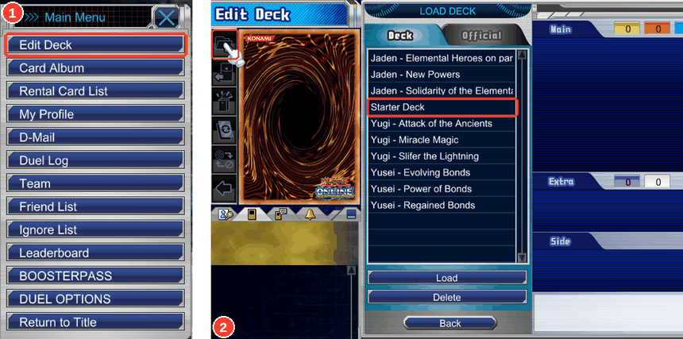
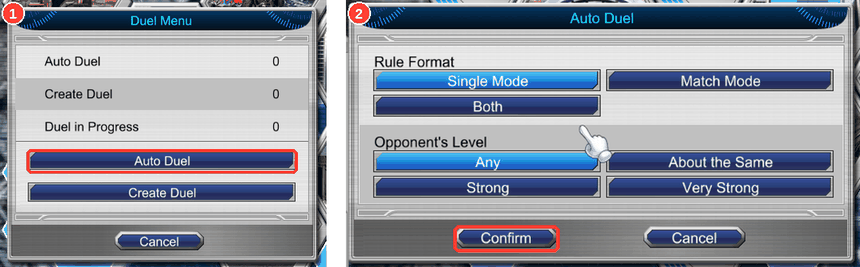

# Hosting and joining: playing Yu-Gi-Oh! ONLINE 3 with friends

For setup through the graphical application, read [the launcher guide](launcher.md). The GUI groups local/remote
play, independent hosting, activity and game settings into four pages. Hosting uses saved configuration; advanced
options stay under My server. Firewall policy belongs to the operating system.

This page is the command-line reference and source-build guide; both routes use the same server, authentication
and game files.

Everyone uses the revival launcher and connection DLL with their own original game install (ver. 1.153). The
server and launcher authenticate each account over TLS. The game executable and `yo3.ini` stay unchanged; no game
files are shipped. These commands apply to **v0.0.4 and later**. For a graphical upgrade from an earlier release,
follow [the upgrade steps](launcher.md#upgrade-from-v003-or-earlier).

**Contents**

- [Hosting and joining: playing Yu-Gi-Oh! ONLINE 3 with friends](#hosting-and-joining-playing-yu-gi-oh-online-3-with-friends)
  - [Play on your own PC](#play-on-your-own-pc)
  - [For the host](#for-the-host)
    - [LAN checklist](#lan-checklist)
    - [Windows SmartScreen and antivirus warnings](#windows-smartscreen-and-antivirus-warnings)
    - [macOS](#macos)
    - [Run from source](#run-from-source)
  - [For every player](#for-every-player)
    - [Joining, step by step (with pictures)](#joining-step-by-step-with-pictures)
  - [What works and what doesn't yet](#what-works-and-what-doesnt-yet)
  - [When something goes wrong](#when-something-goes-wrong)

## Play on your own PC

First [download the current release](https://github.com/usersina/yo3-revival/releases/latest), or
[build from source](#run-from-source). Extract the bundle and open a terminal in the
extracted folder. The host needs its own game install too: the server reads its card, deck and other data.

These commands create a local-only identity. If you plan to host friends, use [For the host](#for-the-host) instead
so their address is included in the certificate from the start.

Windows, in PowerShell:

```powershell
.\yo3-server.exe init-auth localhost 127.0.0.1
.\yo3-server.exe add-account Yugi
.\yo3-server.exe profile Yugi client.json --advertise localhost
Copy-Item .\data\server.crt .\server.crt
.\yo3-server.exe
```

Linux:

```sh
./yo3-server init-auth localhost 127.0.0.1
./yo3-server add-account Yugi
./yo3-server profile Yugi client.json --advertise localhost
cp data/server.crt server.crt
./yo3-server
```

Keep that terminal open. In a **second terminal** in the same folder, follow [For every player](#for-every-player),
using `client.json` instead of `Alice.json`. The raw server defaults to loopback, which is enough for local play.

Initialization and account creation run once. For later sessions, just start the server and launcher. Profile export
refuses to overwrite a file; reuse your existing profile. If the game is installed elsewhere, add
`--game-dir "PATH_TO_GAME"` to the server command as well as to the launcher command.

## For the host

Use an extracted current bundle, with your own game installed. Choose a stable LAN/VPN IP or DNS name that friends
can reach. The example below uses **192.168.1.50**: replace it with your actual address everywhere, including in
`init-auth`. Run setup with the server stopped.

Windows, in PowerShell:

```powershell
.\yo3-server.exe init-auth localhost 127.0.0.1 192.168.1.50
.\yo3-server.exe add-account Alice
.\yo3-server.exe profile Alice Alice.json --advertise 192.168.1.50
.\run.cmd
```

Linux:

```sh
./yo3-server init-auth localhost 127.0.0.1 192.168.1.50
./yo3-server add-account Alice
./yo3-server profile Alice Alice.json --advertise 192.168.1.50
./run.sh
```

The wrappers bind the TLS listener to all network interfaces. When running the server directly, pass
`--bind 0.0.0.0`; **`--advertise` only sets the address in profiles, not the listening interface**. For a non-default
game install, append `--game-dir "PATH_TO_GAME"` to the wrapper or server command.

Privately give Alice `Alice.json` and the public `data/server.crt`. She keeps them together, with the certificate
named `server.crt`. Repeat `add-account` and `profile` with a different name for each friend. Create your own account
and profile too if you will play. Each account can have up to four players; accounts behind one router remain separate.

The profile contains a secret account key. Keep it private and keep `data/server.key` on the host. Unix tools create
private credential files with mode 0600; on Windows use folders private to the intended user.

Allow TCP **7443** through the host firewall and, when needed, forward it through the router or route it through your
VPN. The internal HTTP/admin port (8080 by default) stays on loopback; do not forward it. If you change
`--auth-port`, use that port consistently when exporting profiles and starting the server.

**Existing setup:** keep `data/`. Export `profile EXISTING_PLAYER client.json --advertise HOST` to reuse that player's
account and cards/BP/ids; address-only accounts receive a key. A localhost-only certificate does not cover a LAN IP.
`init-auth` refuses to overwrite an existing identity. To add a sharing address while retaining that identity,
use the graphical manager with the same data folder: stop hosting, save the new sharing address under
**My server → Advanced**, then start hosting. It updates self-managed certificates with the same private key.
Export updated profiles/invitations as needed; do not delete account data or the identity key.
The old `/join` page and INI downloads are retired. See [authentication.md](authentication.md) for the design.

**Backups:** persistent state lives in `data/server.db` (SQLite), imported once from existing JSON files. Consistent
database copies are backed up at server startup. Originals remain as migration copies and no longer receive writes.
See [data and upgrades](launcher.md#your-data-and-upgrades) before restoring or downgrading. The TLS private key and certificate are
not included in those automatic backups: separately back up the entire `data/` directory securely. Players should
also back up their local `Documents/Yu-Gi-Oh! ONLINE 3` folder.

Useful account commands (server stopped except the BP operations):

```sh
./yo3-server accounts
./yo3-server add-player Yugi Joey
./yo3-server rename Joey Joseph
./yo3-server set-country Yugi TN
./yo3-server give-bp Yugi 5000
./yo3-server add-code ABCD1234EFGH5678 2500
```

`--regulation NAME_OR_ID` sets the login banlist; by default it is unlimited. Hosted duels keep their host's choice.

### LAN checklist

- Confirm the server reports `authenticated TLS` on the intended address and port.
- Allow TCP 7443 on the host firewall; with a VPN or router, route/forward that port to the host.
- Check the profile's server address and certificate name against the host's certificate names.
- Give each friend the correct public certificate and their own private profile.
- Launch through `yo3-launcher`, or enable the optional [automatic loader](launcher.md#open-the-game-directly) in the
  graphical manager. An untouched game without that loader cannot authenticate by changing `yo3.ini` alone.

### Windows SmartScreen and antivirus warnings

These are unsigned pre-alpha executables and an injector/DLL, which Windows or an antivirus may flag. Build from
source or review the code before trusting them. The injector loads only the DLL paths supplied to it; it terminates
the game before startup if a required hook fails. Restore files removed by an antivirus only after reviewing them.

### macOS

No macOS bundle or live check is provided. The supported builds are Linux with Wine and Windows.

### Run from source

Build on Linux from the repository root. You need Rust/Cargo, Node.js 22.18 or newer with npm, Git, curl and
32-bit MinGW GCC and binutils (`i686-w64-mingw32-gcc`, `i686-w64-mingw32-dlltool`) for the connection DLL/injector.
The Linux GUI build also needs pkg-config and the X11, Wayland and xkbcommon development libraries (on Debian/Ubuntu:
`pkg-config libx11-dev libwayland-dev libxkbcommon-dev`). Linux players also need Wine.

```sh
git clone https://github.com/usersina/yo3-revival.git
cd yo3-revival
engine/fetch.sh
cargo build --release -p yo3-server -p yo3-launcher -p yo3-desktop
tools/mod/build.sh
```

If you already have a checkout, skip `git clone` and run the remaining commands from its root.

Open `./target/release/yo3-revival` for the graphical application. Use **`./target/release/yo3-server`** in place of `./yo3-server` in the setup commands above, staying in the repository
root. Start it directly (`--bind 0.0.0.0` for friends). To launch the development build:

```sh
./target/release/yo3-launcher --profile client.json \
  --game-dir "$HOME/.wine/drive_c/Program Files (x86)/Konami/Yu-Gi-Oh! ONLINE 3" \
  --injector tools/mod/build/yo3-auth-launch.exe --dll tools/mod/build/yo3-auth.dll
```

To build **both distributable bundles**, also install the `x86_64-w64-mingw32-gcc` toolchain and the archive tools
`tar`, `xz`, `sha256sum` and system `python3`, then run:

```sh
rustup target add x86_64-pc-windows-gnu
tools/release.sh
```

The Linux archive and Windows zip appear in `dist/`. Distribute the matching archive to each player; its rules
engine includes Node, and its launcher finds the DLL and injector beside itself. Never put private profiles or
server keys in a shared bundle.

For development and headless live checks, read [AGENTS.md](https://github.com/usersina/yo3-revival/blob/main/AGENTS.md). Use a scratch data directory, alternate
ports and private Xvfb displays; keep the user's live server and desktop untouched.

## For every player

Start the launcher, using the private profile and game folder:

```powershell
.\yo3-launcher.exe --profile .\Alice.json --game-dir "C:\Program Files (x86)\Konami\Yu-Gi-Oh! ONLINE 3"
```

On Linux:

```sh
./yo3-launcher --profile Alice.json --game-dir "$HOME/.wine/drive_c/Program Files (x86)/Konami/Yu-Gi-Oh! ONLINE 3"
```

The bundle's injector and DLL sit beside the launcher. Linux needs Wine; `--wine-prefix` selects another prefix.
No `yo3.ini` edits are required. Authentication happens before the game starts; its original username/password
fields are unused. A bad key, certificate or DLL stops startup and reports the reason in the launcher's terminal.
Keep that terminal open while playing.

### Joining, step by step (with pictures)

1. Start the revival launcher with your private profile and the host certificate.
2. Press **ONLINE**, dismiss the original login form, then select your player.
3. A legal starting deck is prepared once for a fresh player profile. **Main Menu → Edit Deck** is optional: use it to
   customise your deck or load the other official character decks.



4. **Auto Duel → Confirm** matches two waiting players. To pick a friend, use **Create Duel**, then your friend's
   Player Information → **Send Duel Request**. Choose your deck and play. Computer opponents are at Kaiba Corporation.



Only the matched players can submit decks or start that duel. Create Duel keeps the chosen banlist after acceptance.

## What works and what doesn't yet

The main playable features are:

- **Duels:** NPC opponents, Auto Duel, Create Duel, Single and Match Mode, spectating, and the client's choice dialogs
  and animations.
- **Cards and decks:** Edit Deck, official character decks, booster packs, structure decks, trading and rentals.
- **Community:** chat rooms, whispers, player search, friends, D-Mail, teams and player-run knockout tournaments.
- **Customization:** avatar settings, card protectors and avatar items bought in the shop.

Each account starts with **5000 BOOSTERPASS Points**. Packs cost 100 BP; duels earn 100 for a win, 50 for a draw and
30 for a loss. The shop shows updated points after your next login or purchase. The host can also issue codes,
redeemed through **Main Menu → BOOSTERPASS**. Purchased cards stay on the server; a bought structure deck appears
in Edit Deck's deck list.

Duels between players have clocks: 3 minutes a turn and 10 minutes a duel (or the host's choice in Create Duel), and
running out loses the duel.

To add a friend, open their Player Information (click them in player search) and press Send Friend Request; they
get a friends icon at the top left, and accepting adds you to each other's lists. Main Menu → Friend List shows all your
friends; the search tab's two-people button shows the ones who are online. Friends are kept by the host's server.
In Create Duel, Opponent's Limits → Friend lets only your friends send you a duel request.

Main Menu → D-Mail sends a friend a message (Write Mail, then the friends button to pick them); they see a mail icon
at the top left, or get it at their next login if they were away.

Main Menu → Team forms a team; its leader invites players from their Player Information. A team has its own chat tab
and D-Mail (Send to Team), and Create Duel's Opponent's Limits → Team takes requests only from your team.

Satellite Plaza holds user events: Create User Event makes a knockout tournament, friends press Participate in its
details, and the host starts it from the duel button's Event Menu in the lobby; the server pairs everyone and each
pair duels, round by round, until one is left.

You can watch a friend's duel: find them in player search (they show as duelling), open Player Information and press
Watch Duel. You see the duel from one player's side with both hands hidden, and go back to the map when it's over.

In Match Mode, a player whose deck has a side deck gets the Card Swap screen between duels: drag cards between the
side deck and the main or extra deck, then press the arrow at the top left to go on. Build a side deck in Edit Deck.

The shop also sells card protectors (200 BP) and avatar items (100 BP): Avatar Settings and the deck editor offer
them once bought.

To trade cards, open a player's Player Information and press Send Trade Request; once they accept, drag cards from
your trunk into your half of the table, press Ready to Trade., and answer Yes to "Execute Trade?". A deck that used a
card you traded away no longer counts as valid until you edit it.
Changing either offer withdraws both players' approvals: both must press Ready to Trade. and confirm the new offer.
Existing accounts and accounts made through `add-account` can trade and rent cards too; their collection follows the player.

To lend cards, open a player's Player Information and press Send Rental Request. Once they accept, the lender sets the
conditions (a term of 1, 3, 7 or 14 days, and Free) and double-clicks cards from their trunk into the list, then presses
Confirm; the borrower answers "Borrow these cards?" and the cards join their trunk (marked as borrowed, so they can be
put in decks but not traded) while the lender's copies are out of theirs. When the term is over the cards are back with
their owner, even across a server restart (they are kept in the SQLite rentals document); there is no early return. Both players'
Main Menu → Rental Card List shows what they lent and borrowed. Editor saves live locally in
`Documents\Yu-Gi-Oh! ONLINE 3`; selecting a deck for a duel also uploads it to the server. A deck that used a borrowed
card is no longer valid once the rental ends.

Limitations: this is pre-alpha. Computer opponents use a basic bot, and saving in Edit Deck alone does not sync a
deck to another machine; select it for a duel to upload it. The client has its original card pool and UI. Some reply
fields remain inferred rather than confirmed against Konami's server; [the roadmap](https://github.com/usersina/yo3-revival/blob/main/docs/roadmap.md) lists those choices
and the remaining live checks, including play from separate friends' machines with the new launcher.

## When something goes wrong

- **Authentication failed:** check that this is your private profile for this host. The game has not been started.
- **Certificate or TLS handshake failed:** check the public certificate and the expected DNS name/IP. Use a name
  included by the host when initializing the certificate; certificate checks cannot be bypassed.
- **Cannot connect:** check TCP 7443, the profile's server address, and the host's firewall/VPN.
- **Connection mod did not initialize:** rebuild/restore `yo3-auth.dll` and `yo3-auth-launch.exe` from this version.
  Unsupported imports leave the game suspended and it is terminated; there is no fallback connection.
- **Game cannot find the server:** start it through the launcher, and keep the launcher running.
- **Duels end at once as draws:** inspect the server's `DUELS WON'T WORK` message. Restore the complete `engine/`
  folder from the bundle, or fetch the dependencies and install a compatible Node.js when building from source.
- **A long session disconnects:** launcher sessions expire after 12 hours. Restart the launcher to authenticate again.
- **Found a bug:** open <https://github.com/usersina/yo3-revival/issues/new/choose> with the steps, application version
  and a diagnostic ZIP from **Activity → Export logs…** when using the GUI. Review it before sharing. Do not attach
  private profiles, account keys, databases or `server.key`. Game packet logs exclude transport credentials.

The graphical application also supports [confirmed application updates](launcher.md#application-updates), with a visible version, GitHub link and startup release check. Advanced setup is under expandable sections.
