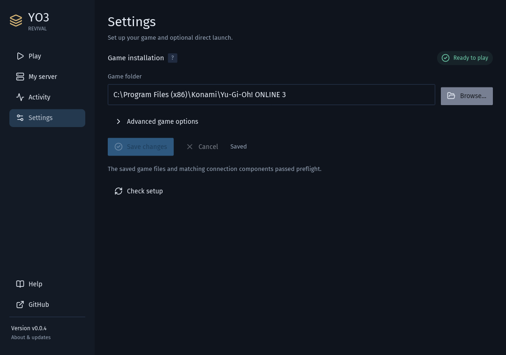
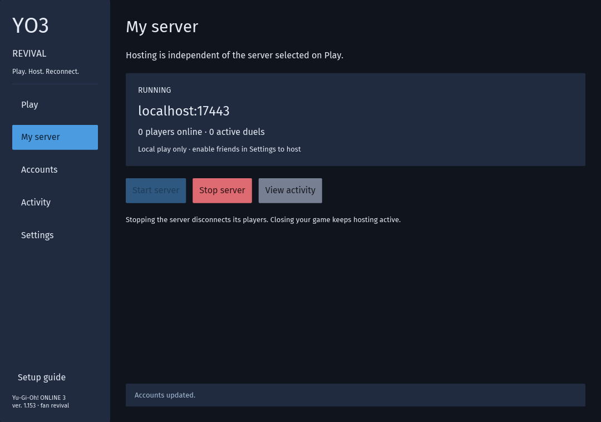
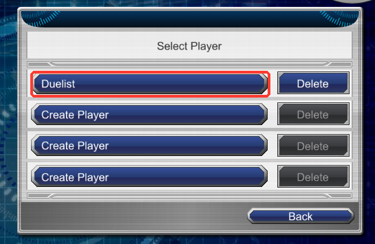
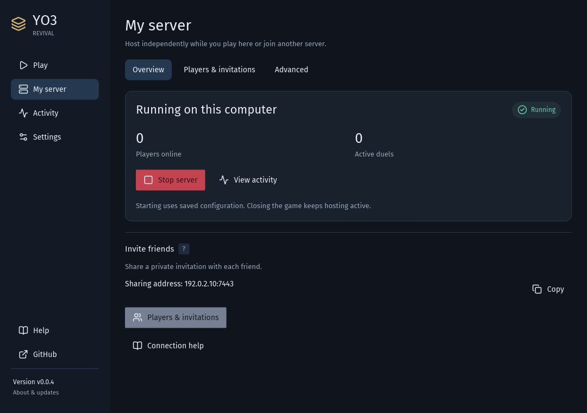
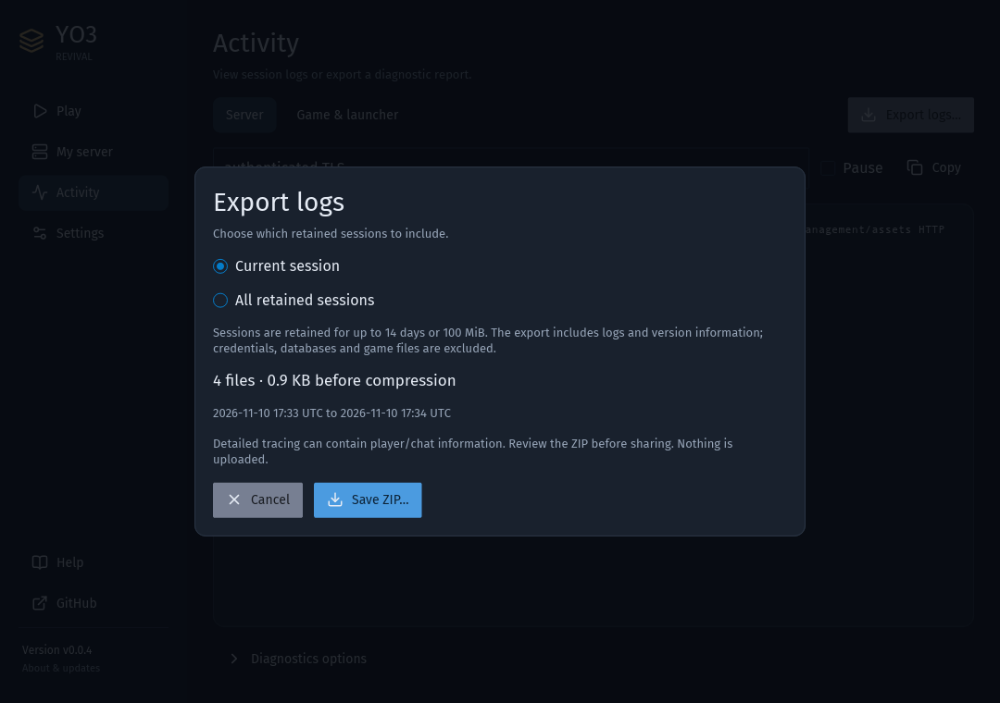

# YO3 Revival: play and host from one window

[Download the latest release](https://github.com/usersina/yo3-revival/releases/latest), choose the Windows ZIP or
Linux archive, and extract the complete bundle. Open **yo3-revival.exe** on Windows or **yo3-revival** on Linux.
The graphical launcher is included from **v0.0.4** onward; no terminal or development tools are needed.

The four pages are **Play**, **My server**, **Activity** and **Settings**. Help, GitHub and the current version are
at the bottom of the sidebar. Question-mark tooltips explain unfamiliar settings. Advanced options stay collapsed
until you need them.

**Contents**

- [First launch](#first-launch)
- [Play locally](#play-locally)
- [Join another server](#join-another-server)
- [Host friends](#host-friends)
- [Connection help](#connection-help)
- [Open the game directly](#open-the-game-directly)
- [Logs and support](#logs-and-support)
- [Application updates](#application-updates)
- [Your data and upgrades](#your-data-and-upgrades)
- [Upgrade from v0.0.3 or earlier](#upgrade-from-v003-or-earlier)
- [Troubleshooting](#troubleshooting)
- [Getting the original game](#getting-the-original-game)

## First launch

Install your own **Yu-Gi-Oh! ONLINE 3 ver. 1.153**. Linux players also need Wine. Our bundle includes the server,
rules engine, connection DLL and launcher; it contains no original game files.

In **Settings**, choose the folder containing `yo3.exe`, `yo3.idx` and `package/`, then **Save changes**. If the
correct game folder is already detected, leave it in place. A separate Wine prefix can be selected under
**Advanced game options** on Linux; Wine settings do not appear on Windows. Each section saves only its own
fields; **Cancel** discards that section's draft. Start and Play use saved configuration.

The saved setup checks the complete game data, injector and matching connection DLL. **Ready to play** means the
preflight succeeded. **Continue to Play** finishes first-time setup. If something is missing, **Repair**
explains whether to choose a complete game installation or restore the complete application bundle from a release
download. Recheck after restoring files. Our DLL also acknowledges readiness before authentication and game resume.
The original executable and INI stay unchanged. If you are moving from an older release, follow the
[upgrade steps](#upgrade-from-v003-or-earlier) before starting your server.

## Play locally

On **Play**, select **My server** and press **Play**. The launcher creates the first local account if necessary and
starts its local server automatically. No sharing address or firewall configuration is needed for local play.
The account dropdown controls your game login; managing another account under My server does not change it.

The UI reports **Starting game** until the authenticated launcher signals readiness, then **Game running**.
**Close game** ends that session while hosting can continue. On Wine, a cold prefix can take longer to initialise;
startup failures appear on Play and in **Activity → Game & launcher**.

In the game, select **ONLINE** and choose your player. The mod skips the original login form because the launcher
already authenticated your account. On a fresh player profile, the mod prepares a legal starting deck and selects
it if you have no selection. This runs only once: existing decks, even unfinished
ones, and all later edits or deletions are preserved.

Visit **Kaiba Corporation** for a computer opponent or use **Auto Duel** with a friend.
**Main Menu → Edit Deck** is available whenever you want to customise your decks.

## Join another server

Choose **Play → Import invitation**, select the private file from the host, then **Save connection**. The invitation
contains the server address, identity and private account key. Existing authenticated `client.json` profiles can
also be imported with their adjacent public certificate.

Alternatively choose **Add server**. Enter the host's DNS name or IP, optionally with a port (default **7443**), then
**Check server**. The check sends no account credentials. It displays the server version and compatibility, and asks
you to compare its identity code with the host. Approve the identity, enter your account key and save the connection.
`yo3://host:port` addresses work too. Later connections verify the remembered identity automatically.

Use **Test connection** to check the account from this computer, then **Play**. **Edit** changes
a saved name, address or key. Changing an address requires checking its identity again. **Remove** deletes only the
saved connection and its local cached profile; it leaves the account and game data on the host. Close the game before
changing its connection or account. Accounts sharing a router stay separate.

## Host friends

Hosting and playing are independent. You can host your own server while joining someone else's, or keep hosting
after closing the launcher.

1. Open **My server → Advanced** and set a sharing address friends can reach: your LAN/VPN address or public hostname.
2. Keep the default interface or choose a specific one and TCP port, then **Save changes**.
3. In **Overview**, choose **Start server**. It uses saved settings.
4. In **Players & invitations**, create an account for each friend and export its private invitation.

Account selection here is for administration; it does not switch your account on Play. Each account can hold up to
four players. **Additional players** adds one to the selected account; the player is chosen inside the game.
Send invitations privately to their account owner. They contain credentials and do not belong in bug reports.

The default listener is **all IPv4 interfaces (`0.0.0.0`)**. Advanced also offers localhost, IPv6 and available
interfaces. A saved interface follows DHCP changes; an unavailable interface reports an error instead of widening
the listener. The sharing address is separate: `0.0.0.0` and localhost are never presented as addresses for friends.
An explicit external `:port` in the sharing address supports router/VPN port mappings.

Stop your server before saving hosting changes. Its data folder and first player for a new server are also under
Advanced. The overview reports **Running on this computer**, online players and duels; that is local process status,
not proof that the address is reachable from another network. **Stop server** disconnects its players.

The screenshot uses an example sharing address. Use an address your friends can actually reach.

## Connection help

If friends cannot connect, confirm the sharing address and the saved TCP port, and check that your server is running.
A connection test from the host does not establish reachability from a friend's computer. A timeout alone cannot
identify a firewall, VPN or router as the cause.

Manage firewall policy in your operating system. On Windows, allow the server application using
[Windows Security's firewall tools](https://learn.microsoft.com/windows/security/operating-system-security/network-security/windows-firewall/tools).
On systems using firewalld, its [port/service guide](https://firewalld.org/documentation/howto/open-a-port-or-service)
explains the interface/zone and persistent settings. Use the port shown under **My server → Advanced** (default TCP
7443). The launcher neither edits firewall rules nor configures a router/VPN. Start never elevates the application.
Router forwarding, when needed, points to the host computer's chosen listener; never forward the internal admin port.
An application-specific Windows allowance may need updating when a new version has a different executable path.

The server automatically maintains its self-managed certificate when starting, preserving the identity key and
backing up the prior certificate. Same-key renewal retains invitation trust. Invalid or incomplete identity files
are reported rather than replaced. Certificate recovery belongs in troubleshooting, not the normal join flow.

## Open the game directly

After saving the game folder and selecting your server/account, open **Settings → Advanced game options** and choose
**Enable direct launch**. Start your local server first if that is the selected connection. You can then open the
original `yo3.exe` or its usual shortcut. Direct launch uses the saved connection; it does not start a stopped server.

The status reports **Disabled**, **Enabled**, **Needs repair** or a mod conflict. **Repair direct launch** refreshes
our owned loader and private configuration after an update or a missing-file problem. It preserves the game executable
and refuses to replace another mod. **Disable direct launch** removes the owned setup. Disable it before changing the
saved game location or Wine prefix.

Setup adds an owned `winmm.dll` loader and receipt beside the game. Credentials and configuration stay in private
application storage; Windows records only the config path in your user's registry, and Wine uses the chosen prefix.
A protected game folder may request permission for this explicit component installation/removal. Firewall policy is
unrelated to that permission.

The loader checks the DLL hash, readiness and authenticated server compatibility before login. A missing DLL offers
its expected path and a matching-file picker followed by restart. An untouched game with no loader can only show its
original generic connection failure: a server cannot inspect files on another computer.

## Logs and support

**Activity** shows Server or Game & launcher logs. Filter them, pause updates or copy the displayed text. **Export logs**
offers **Current session** or **All retained sessions**, then previews the file count, date range and size before saving
one ZIP. The current scope includes this manager, its attached server and latest game run; all retained sessions
includes current and older history. Nothing is uploaded.

Logs rotate at 2 MiB and are retained up to 14 days or 100 MiB, preserving active process logs. The viewer reads at most
96 KiB. Under **Diagnostics options**, enable **Detailed tracing and duel validation**, then save that section.
The next hosted server starts with `--duel-check`: it compares both players' modeled client state with the rules
engine after every step and logs a mismatch. It includes battle animations that hide cards, beyond occupied slots.
The next game also captures its detailed trace. A server already running needs a stop/start between games to apply
this setting. Detailed tracing can contain chat/player information, so turn it off after investigating and review
the ZIP before sharing. Credentials, databases, private keys, profiles and game files are excluded from reports.
Developer packet logs outside the indexed session directory are not part of these exports.

Closing the launcher asks whether to keep hosting or stop the server. A game started here closes in either case;
a game opened independently has its own lifetime. Reopening the launcher attaches to a running local server and its
session logs. The server records logs independently of the manager window.

## Application updates

Click the footer version to open **About & updates**. The launcher checks GitHub at startup; an offline or rate-limited
check leaves Play available. Only newer published stable releases for your platform are offered; development builds
stay in place. GitHub is also linked in the footer.

Choose **Review & install**, read the notes, then **Download & restart** to confirm. Progress and cancellation remain
available while downloading. The launcher verifies SHA-256 and the complete component manifest, extracts into private
version folders, then closes its managed game and restarts hosting. Finish duels first: online players disconnect.
Settings, connections and server data remain in place. The game stays closed until you choose Play again.

The new window must acknowledge readiness before its version becomes active in SQLite. Download, verification or
startup failure leaves the previous version available. Original launcher shortcuts route to the active newer version;
keep the original bundle if using that shortcut or an older direct-launch setup. Version folders are under
`updates/installs/` in application storage, with the active/previous choices in `launcher.db`.

After an update, direct launch may show **Needs repair**: use its Repair action to refresh owned components.
Windows firewall allowances remain managed in the OS. No administrator access is needed for an update into your own
application storage.

## Your data and upgrades

The default application folder is `%LOCALAPPDATA%\YO3 Revival` on Windows and
`${XDG_DATA_HOME:-~/.local/share}/yo3-revival` on Linux. **Activity → Diagnostics options → Open application data** opens it.

- `launcher.db` holds preferences and saved connections, including their private account credentials.
- `server/server.db` holds the hosted server's persistent game state.
- `server/server.crt` and `server/server.key` are its public certificate and private TLS key.
- `logs/` holds diagnostic logs; `profiles/` contains private launcher profiles.

To use an existing server's data, stop that server and select its data folder in **My server → Advanced** before starting the manager's
server. The upgrade imports accounts, collections, BP, decks, records, social data, mail, teams, events and rentals into
SQLite in one transaction. IDs and credentials remain intact. Original JSON files are retained and are **not** used as
live storage after import. A failed import reports an error and can be retried after repairing its source.

The first SQLite schema preserves the existing domain serializers as transactional documents. It changes storage,
not the client protocol. Live account administration rolls back its memory changes if persistence fails.

At startup the server makes consistent SQLite backups under its data folder's `backups/`. Separately back up the
entire data folder securely: automatic database backups do not include `server.key`. Keep players' local
`Documents/Yu-Gi-Oh! ONLINE 3` too, because editor-only deck saves stay there.

Restore a database backup only with the server stopped. A migrated directory with a missing database reports an error
rather than silently reimporting stale JSON. Returning to an older server requires the original pre-upgrade JSON
snapshot; it cannot read SQLite or retain subsequent database-only changes.

## Upgrade from v0.0.3 or earlier

This is the first release with the graphical launcher, so this upgrade starts with a manual download. Later
versions can be installed through **About & updates** after confirmation.

1. Stop the old server. Securely back up its **entire `data/` folder**, plus players' local
   **`Documents/Yu-Gi-Oh! ONLINE 3`** folders. Keep the old bundle and backup until the upgrade works.
2. Extract the complete new bundle into a separate folder and open **yo3-revival.exe** or **yo3-revival**.
   Set your game folder in **Settings**.
3. Before starting hosting, open **My server → Advanced**, select the old server's **data folder**, set the
   sharing address if friends will join, and **Save changes**. Selecting a folder uses it directly; it does not
   copy its contents. Do not run the old and new servers against the same folder together.
4. Choose **My server → Overview → Start server**. Existing accounts, cards, BP and records import into SQLite
   automatically. The original JSON files remain as migration copies. The launcher creates or maintains the server
   identity without replacing an existing private key.
5. In **Players & invitations**, choose each existing account and **Export private invitation…**. Send the new
   invitation privately to its owner; they import it on **Play** and choose **Save connection**. Existing account
   credentials and player data carry over; do not create replacement accounts for existing players.
6. Allow the chosen **TCP port (7443 by default)** through the host firewall/VPN/router. Older raw game ports and
   the browser `/join` page are retired. Start the game through the launcher or enable optional direct launch;
   changing `yo3.ini` cannot authenticate an unmodified client.

If importing fails, stop and inspect **Activity**. Repair the reported source problem and retry; do not delete
account data or SQLite migration markers to force a reimport. See [Your data and upgrades](#your-data-and-upgrades)
for backups and rollback limits.

## Troubleshooting

- **Incomplete game:** choose a full supported installation rather than an installer or a shortcut.
- **Server executable/engine missing:** extract the entire application bundle, including `engine/` and its Node runtime.
- **Cannot connect:** check the address/port, that the host is running and its firewall/VPN permits the connection.
- **Identity error:** confirm changes with the host or import their updated invitation. Automatic certificate renewal
  with the same identity does not require approving a new key. An expired certificate still needs renewal by the host.
- **Authentication refused:** the key belongs to an account on that specific server; import the correct invitation.
- **Game startup fails:** see **Activity → Game & launcher**. The supported client and required DLL must match.
- **Account name refused:** use a unique player name, 1–16 characters, and at most four players per account.
- **Long session disconnected:** launcher sessions last 12 hours; close and launch the game again.
- **Windows warnings:** the executables and injection DLL are unsigned. See the
  [Windows notes](guide.md#windows-smartscreen-and-antivirus-warnings).

The [command-line guide](guide.md) remains available for developers and unattended hosting, and
[authentication.md](authentication.md) explains the TLS/launcher design.

## Getting the original game

Bring a supported original installation; the application does not download or distribute the game.
A third-party archive reference is the [MyAbandonware game listing](https://www.myabandonware.com/game/yu-gi-oh-online-3-duel-accelerator-qy4).
This reference stays in documentation, separate from the launcher's Play and hosting actions.
