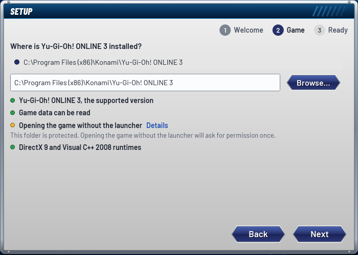
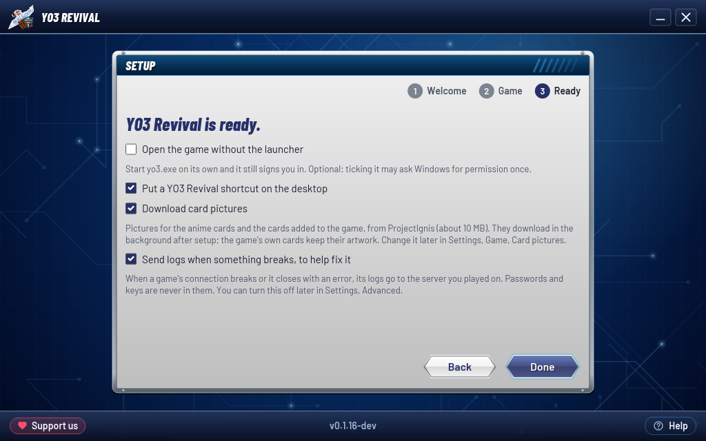
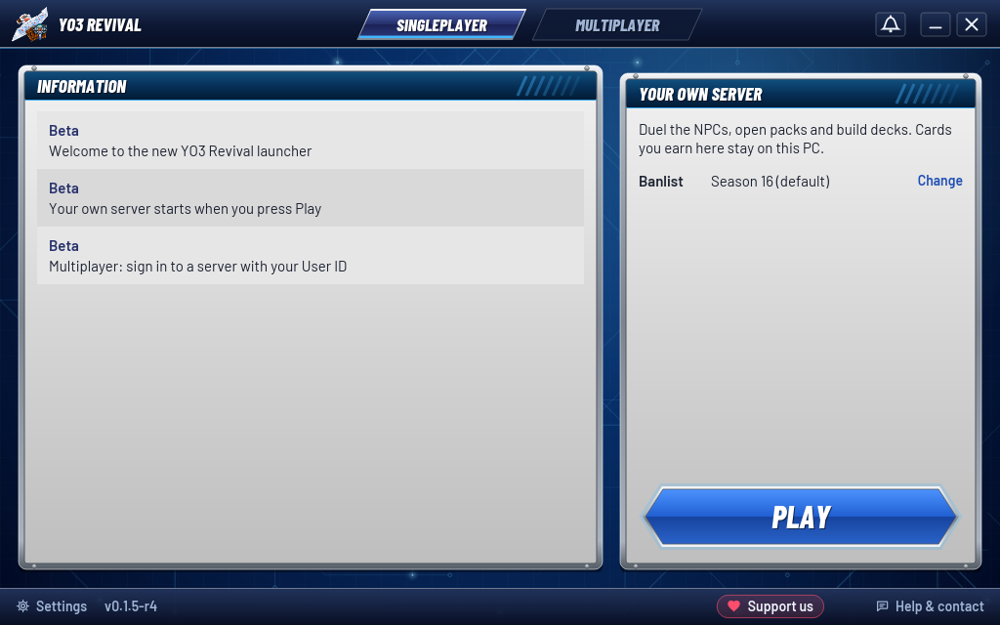
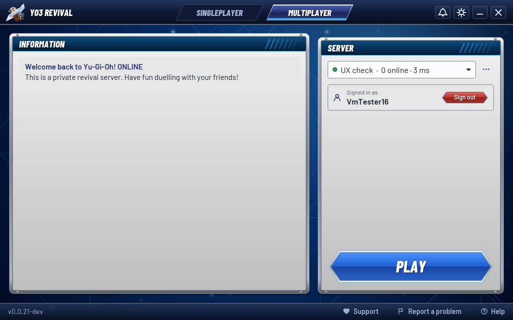
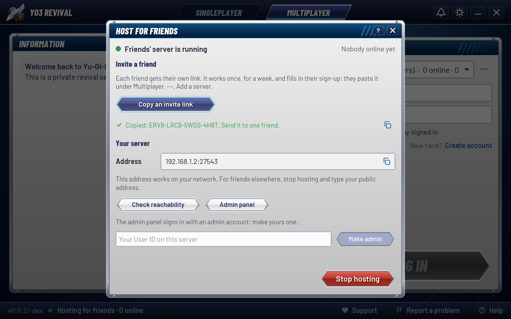
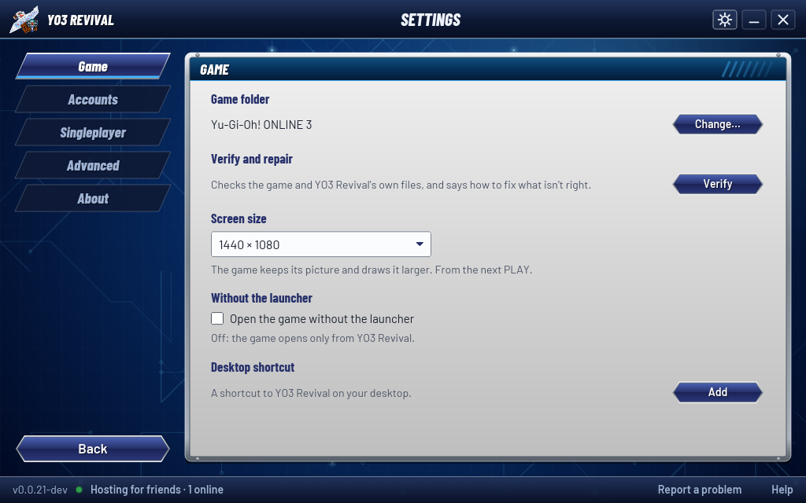
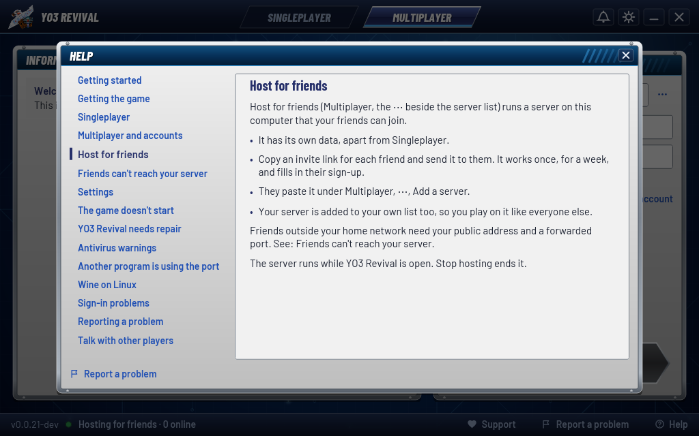

# Desktop guide

> **On the `beta` branch** the Desktop window is the new launcher of the public beta
> ([#20](https://github.com/usersina/yo3-revival/issues/20)). Installing an update from inside the window returns with
> [#32](https://github.com/usersina/yo3-revival/issues/32); until then the footer says when one is out and links to it.

Use **Desktop** for a window with setup, a Play button, settings and help. Use [Scripts](scripts.md) if you prefer a
terminal. Both editions include the server, rules engine and required connection components. Game files are separate.

- [Desktop guide](#desktop-guide)
  - [First launch](#first-launch)
  - [Singleplayer](#singleplayer)
  - [Join another server](#join-another-server)
  - [Host friends](#host-friends)
  - [Settings](#settings)
    - [Screen size](#screen-size)
    - [Banlist](#banlist)
  - [Open the game directly](#open-the-game-directly)
  - [Help and errors](#help-and-errors)
  - [Logs and support](#logs-and-support)
  - [Application updates](#application-updates)
  - [Your data and upgrades](#your-data-and-upgrades)
  - [Reset local game data](#reset-local-game-data)
  - [Troubleshooting](#troubleshooting)
  - [Getting the original game](#getting-the-original-game)

## First launch

You need a complete original **Yu-Gi-Oh! ONLINE 3 v1.153** installation and **64-bit Windows 10/11** or **Linux with Wine**.
**Windows 7 is not supported in either Desktop or Scripts; compatibility work is out of scope for now.**
macOS does not have a supported build. [Game installation help](#getting-the-original-game).

1. [Download the latest release](https://github.com/usersina/yo3-revival/releases/latest). Choose the **Desktop**
   archive for your system and extract **all** of it.
2. Open `yo3-revival.exe` on Windows or `yo3-revival` on Linux inside `yo3-revival-desktop/`.
   On Windows, look for the Duel Disk icon with the Monster Reborn badge.
3. The first time, **Setup** opens. It has three steps: **Welcome**, **Game** and **Ready**.
4. On **Game**, YO3 Revival lists the copies of the game it found: Program Files on every drive (Windows), or your
   Wine prefixes, including Lutris and Bottles ones (Linux). Pick one, or use **Browse…** to choose the folder that
   holds `yo3.exe`. On Linux, **More options** sets the Wine prefix.
5. Wait for the checklist. Each line is green, amber (a warning) or red, with one sentence on how to fix it and
   **Details** for the technical text. **Next** opens once nothing is red.
6. On **Ready**, choose whether the game may open without the launcher, and whether to put a shortcut on your
   desktop, then click **Done**.
7. Click **PLAY**. In the game, choose **ONLINE**, then select your player. [Start your first duel](playing.md#your-first-duel).

The checklist:

| Line | Red or amber means |
| --- | --- |
| Yu-Gi-Oh! ONLINE 3, the supported version | No `yo3.exe` in that folder, or another version of the game |
| Game data can be read | `yo3.idx` or the game's data files are missing or damaged: reinstall, or choose a complete copy |
| Wine is installed (Linux) | Wine is missing (the line says how to install it on your distribution), or the chosen prefix doesn't exist |
| DirectX 9 and Visual C++ 2008 runtimes | The line names the runtime to install, then **Retry** |
| Opening the game without the launcher | Amber only: the folder is protected (Windows asks for permission once, the first time it's needed) or read-only (the game then opens only from YO3 Revival) |
| YO3 Revival needs repair | Shown only when YO3 Revival's own files are missing or changed, often after an antivirus scan: **Repair** explains how to restore them |

Later starts are quick: YO3 Revival remembers a fingerprint of `yo3.exe` and runs the full check again only when the
game changed. If the game folder disappears (moved, or a drive unplugged), the main screen says **We can't find your
game** with **Fix**, which reopens Setup at the Game step. Settings → Game → **Change…** reopens it too.

## Singleplayer

**PLAY** starts your own server, then the game, and the line above the button names each step; after 30 seconds
without the game, **Cancel** stops what it started. While you play, **Close game** asks the game to stop and forces it
after 10 seconds. Your server stops 30 seconds after the game exits, so a quick relaunch reuses it. If YO3 Revival
crashes, the game keeps playing and your server stops by itself once nobody has played for two minutes. A game opened
without the launcher shows as **PLAYING**, so a second copy can't be started.

Your first legal starting deck is prepared and selected once, without opening Edit Deck. Existing decks and later
edits are kept. See [the playing guide](playing.md) for computer opponents, friends and decks.

The panel shows the [banlist](#banlist) your server uses, with **Change**. Cards you earn in Singleplayer stay on this
PC. If its data can't be opened, the notice offers **Restore a backup** (your server keeps one from each of its last
starts, newest first); Settings → Singleplayer has the backups, a reset and the data folder.

## Join another server

The **Multiplayer** tab signs in to servers with a User ID and password ([accounts](authentication.md#accounts)):

- **The server list**: the official servers (from a list signed by the project, once it publishes one) and the ones you
  added under **Other servers**, the last one you played on first. Each shows whether it is online, with how many
  players and its ping, or Maintenance, Offline, Needs a newer launcher, or Identity changed. The Information panel shows
  the chosen server's news.
- **Other servers**: paste an invite link a host sent you (`yo3revival://server?…`), or type an address (`host` or
  `host:port`). An invite link carries the server's identity, so it is added at once. An address shows the server's
  name first; **Details** shows its identity, to compare with one the host gave you. YO3 Revival checks the identity on
  every connection after that. If it ever changes, the server's row says so and nothing connects: remove the server and
  add it again only if the host confirms the change.
- **Create account**: a User ID (3 to 16 letters, digits, `_` or `-`), a password of at least 8 characters, typed twice,
  and the server's invite code when it asks for one. You then see a **recovery code** once: save it.
- **LOG IN**: **Save User ID** keeps only the name. **Stay signed in** keeps a sign-in token in your system's credential
  store (Windows Credential Manager, or the Secret Service on Linux), never the password; without such a store it is
  off and says why. Wrong User ID or password get the same message, and repeated tries wait longer each time.
- **Forgot password?**: your recovery code (or a reset code from the server's moderators, who check it's you first) and
  a new password. A recovery code is replaced by a new one, shown once.
- **PLAY** starts the game signed in to the server; **Close game** works as in Singleplayer. **Sign out** forgets this
  PC's sign-in. Signing in elsewhere ends this game's session: the newest sign-in wins. PLAY checks your sign-in first:
  if it ended (the server restarted, a moderator, or a sign-in on another PC), **Stay signed in** starts a new one, and
  otherwise you sign in again.

Settings → Accounts lists every server you're signed in to on this PC, with Sign out everywhere and Change password.

## Host friends

**Host for friends**, on the Multiplayer tab, runs a server on this PC that your friends join, like a game's "Open to
LAN". It is the same server as Singleplayer's, with its own data (its own accounts, cards and decks), and it runs while
YO3 Revival is open.

1. On the Multiplayer tab, click **Host for friends**.
2. Give your server a name. Keep port **7443** unless something else uses it. Leave **Address to share** empty for
   this PC's network address (friends on your home network reach it), or type your public address or a name such as
   `play.example.com` for friends elsewhere (see [Friends can't connect](#troubleshooting)).
3. Click **Start hosting**. The dialog shows the **Address** and the **Invite link**, each with **Copy**, and an invite
   code. Send each friend the link and their own code: **New code** makes another. A code works once, for a week.
4. Your friend pastes the link under Multiplayer → **Other servers**, clicks **Create account** and uses the code.
5. Your server is in your own Multiplayer list too, as **(yours)**: make your own account there with a code, and play
   on it like everyone else.

The footer says **Hosting for friends** with how many players are online; click it to open the dialog again.
**Check reachability** asks your server at the address you share. From this PC that also needs your router to loop the
connection back, so a failure there means "maybe", not "no". **Admin panel** appears when your server serves one
([#36](https://github.com/usersina/yo3-revival/issues/36)). **Stop hosting** ends the server; friends' duels end as
draws. Closing YO3 Revival stops it too, and asks first while friends are online.

Only the TLS port needs to be reachable. If another program has it, the dialog says so in one line with **Change
port**. Singleplayer and hosting can't share a port at the same time: with the defaults, your Singleplayer server gives
way when you start hosting while nobody plays on it, and PLAY in Singleplayer asks you to stop hosting first.

For a server that runs without the launcher (an always-on PC or a VPS), use the server on its own: the
[command-line reference](guide.md) and the [Scripts edition](scripts.md#host-friends).

## Settings

The gear at the top right opens **Settings**; **Back** or Escape returns to the main screen. Every change is saved at
once and applies at the next PLAY (or your server's next start), without restarting YO3 Revival.

| Section | What it has |
| --- | --- |
| Game | The game folder (**Change…** opens Setup), **Verify** (checks the game and YO3 Revival's own files in full, and says how to fix what isn't right), the [screen size](#screen-size), [opening the game without the launcher](#open-the-game-directly) with its state and **Fix permission** when the game folder needs it, and **Add** for a desktop shortcut |
| Accounts | Each server you're signed in to on this PC: **Sign out**, **Sign out everywhere** (every PC signed in to the account must sign in again; asks for the password when this PC didn't stay signed in) and **Change password** (signs every PC out, this one too) |
| Singleplayer | The [banlist](#banlist), **Back up now**, **Restore…** (a backup from a recent start), **Reset…** (starts your Singleplayer data again; the old data is kept beside it, renamed) and **Open data folder** |
| Advanced | On Linux, the Wine prefix and the Wine program (empty for Wine's defaults; **Save** checks it); **Detailed logs** for your servers; **Export logs…** and **Open logs folder**; [Reset local game data](#reset-local-game-data) |
| About | The version, **Check for updates**, release notes, the project, licences and credits |

### Screen size

Settings → Game → **Screen size** draws the game larger and sharp, in its own 4:3 shape. Menus, text and the duel
field are drawn at the new size; card pictures and backgrounds keep the detail their files have, so they are scaled up.
**Original (1024 × 768)** is the game as it always was. **Fit my screen** picks the largest window your screen holds;
a size such as **1440 × 1080** is the game window's size. If the window doesn't fit, Windows or Wine keeps it smaller
and the game fits inside, with black bars when the shapes differ.

The game's own **Full** screen setting (title screen → **Options** → **Screen**) becomes a borderless window the size
of your screen, the game centred with black bars beside it: on a 1920 × 1080 screen it is drawn at 1440 × 1080.
Changing **Screen** there closes the game, as it always has; the mode applies the next time you play.

The size applies at the next PLAY. Opening `yo3.exe` [directly](#open-the-game-directly) always uses the original
size. If the higher resolution can't be used with your game files, the game doesn't start: choose **Original** to play.

### Banlist

Settings → Singleplayer → **Banlist** sets the Forbidden/Limited list your own server checks decks against. Auto Duel
and duels against the computer use it, and Edit Deck shows it as the **Latest Regulation**. **Season 16** is the
default, the newest list the game has, as on the original server; choose **unlimited** for no banned or limited cards,
or any of the game's other lists. **Create Duel** can still pick another list for one duel. The Yugi, Jaden and Yusei
character decks hold cards Season 16 forbids or limits, so players edit them first. It changes while the game is
closed and applies at your server's next start.

## Open the game directly

With **Open the game without the launcher** on (Setup's Ready step, or Settings → Game), PLAY sets things up so that
`yo3.exe`, or its Start menu or desktop shortcut, plays what you last played here, without this window. Each PLAY,
Singleplayer or Multiplayer, keeps it up to date. Settings → Game says whether it is set up, or that the next PLAY does
it.

- **Singleplayer:** your own server starts with the game if it isn't running, and stops about 30 seconds after the
  game closes. If it can't start, the game says "Failed to connect to server." and YO3 Revival's logs say why.
- **Multiplayer:** with **Stay signed in**, the game goes straight to Select Player. Without it, or once that sign-in
  has ended, **ONLINE** shows the game's own login screen: type your User ID and password there. **Save Password**
  keeps this PC signed in (the next start skips the screen); **Save User ID** fills in your User ID next time. The game
  never stores the password itself. Its screen takes letters and digits only, up to 16 characters: with a longer
  password, or spaces or symbols in it, sign in with YO3 Revival instead. A wrong password gets "Incorrect User ID or
  Password", a ban "This User ID is currently restricted.", a server that is down or in maintenance "Failed to connect
  to server."; a server that needs a newer YO3 Revival adds one line saying to open it and update.

The setup adds an owned `winmm.dll` loader and a small receipt beside `yo3.exe`; the game's own files are never
changed. Your sign-in stays in the system's credential store (on Linux, also in the game's Wine prefix), never a
password. The connection helper is copied into the app's own data folder, so moving or updating YO3 Revival leaves
direct start working; if that copy is gone, the game opens offline and one line says to open YO3 Revival once. It never
replaces another mod's file of that name: the setting then says so, and PLAY here still works. In a protected game
folder, PLAY never asks for permission by itself: its notice offers **Allow**, and Settings → Game offers **Fix
permission**. Turning the setting off takes the loader out of the game folder again.

**Delete Login Data** on the game's title screen ends this PC's saved sign-in for the server you last played on: the
server forgets it too, and the game's saved User ID is cleared. Singleplayer has nothing to delete. After an update or
a changed Wine prefix, the next PLAY refreshes the setup the same way. Choosing another game folder takes it out of the
old one first.

## Help and errors

**Help** in the footer opens the guide inside the launcher, a topic at a time: getting started, Singleplayer,
Multiplayer, hosting, settings and the common problems. Its **Report a problem** starts a report.

Every error is one plain sentence with one action: its own (**Retry**, **Fix**, **Repair**, **Allow**, **Restore a
backup**) or **Report**. **Help** opens the topic for that error. **Details** shows the technical text, with your
folders written as names such as `<game>` or `<app data>`, and **Copy** puts it on the clipboard.

## Logs and support

**Report a problem** (in the footer, in Help, or beside an error):

1. Say what you were doing and what went wrong.
2. Click **Open the report form**. YO3 Revival saves this session's logs in a ZIP, with personal details removed, opens
   the folder that holds it, and opens the project's report form in your browser, filled in with your words, the
   version and the error.
3. Drag the ZIP into the form and submit it. Nothing is sent until you submit the form yourself.

The logs leave out credentials, databases, private profiles and game files. Reports are public: the ZIP can still hold
player names, chat and decks, so look through it if that matters to you.

Settings → Advanced → **Export logs…** saves the logs in a ZIP of your choosing, also with personal details removed;
**Open logs folder** shows them. **Detailed logs** makes your servers write more (their debug level) from their next
start; turn it on to reproduce a problem for a report, then off again.

Logs rotate at 2 MiB and are kept for up to 14 days or 100 MiB. A remote player's export can't include the host's
server logs: the host exports those separately. For a duel bug that needs state checks and exact replay, the host runs
the server with `--duel-check` ([developer replay and validation](development.md#duel-diagnostics)).

## Application updates

The footer shows the version. When a newer release is out, it says **Update X is available: see what's new**, which
opens the release page; Settings → About → **Check for updates** asks again. Download the new Desktop archive and
extract it in place of the old folder: your settings and data are kept in the app's storage. Installing an update from
inside the window returns in a later beta version ([#32](https://github.com/usersina/yo3-revival/issues/32)).

Archives have versioned filenames, but stable inner folders: `yo3-revival-desktop/` and `yo3-revival-scripts/`.
Do not overwrite a running bundle. [Scripts updates](scripts.md#updates) are manual.

## Your data and upgrades

App storage is `%LOCALAPPDATA%\YO3 Revival` on Windows and `${XDG_DATA_HOME:-~/.local/share}/yo3-revival` on Linux.
Settings → Singleplayer → **Open data folder** and Settings → Advanced → **Open logs folder** open parts of it.

| Location inside app storage | Contents |
| --- | --- |
| `launcher.db` | Settings and your Multiplayer servers (never a password) |
| `singleplayer/` | Your own server: `server.db` (accounts, cards, decks, BP, mail, duel logs), `server.crt` and `server.key` (its identity), `backups/` |
| `hosting/` | Host for friends' server, the same files as `singleplayer/` |
| `logs/`, `profiles/` | Diagnostics, and the private files the game's helper reads |
| `reports/` | ZIPs saved by Report a problem |

Each server start makes a consistent database backup under its folder's `backups/`. These backups exclude the identity
key: to keep everything, back up the **whole folder** with the server stopped. Players should also back up their local
`Documents/Yu-Gi-Oh! ONLINE 3` folder, which holds editor-only deck saves, and `Documents/YO3 Revival/servers/`,
which holds the same for every server after the first ([details](playing.md)).

The beta starts with new data: it doesn't read a v0.0.x Desktop's hosting data or invitations. Restore only with the
server stopped. Older releases can't read newer data; downgrading needs the backup taken before the upgrade.

## Reset local game data

For broken game preferences or saved stock login details, close every game window and choose Settings → Advanced →
**Reset local game data** → **Reset…**, then:

- **Display and login settings** resets the game's options and cached stock logins, keeping player files, saved decks,
  deck selection and starter setup markers.
- **All local game data** moves the whole local folder into the backup, and the game makes fresh files next launch.

Server accounts, cards and BP stay on the server either way. Dated backups live in `.yo3-revival-backups/` beside the
game's local data folder in Documents; a full backup contains the original folder as `data/`. Windows Documents
redirection and the chosen Wine prefix are respected. Wine prefixes can share this folder, so close games in other
prefixes too. Reset works on `Documents/Yu-Gi-Oh! ONLINE 3`, the folder of the first server you played on; other
servers' folders under `Documents/YO3 Revival/servers/` are left alone.

To restore, close the game and move newly created files aside first. For a full reset, move the backup's `data/`
folder back to the original location; for the settings reset, move `options.y3o` and `users/` back from the backup.
Keep backups private: they can contain personal files and cached stock login details.

## Troubleshooting

Help in the footer has these topics too; an error's **Help** opens its own.

| Problem | What to do |
| --- | --- |
| Downloaded Revival but have no game | [Install the original game separately](#getting-the-original-game), then choose its installed folder in Setup. |
| PLAY says SET UP, REPAIR or RETRY | Click it: Setup opens at the game folder, Repair explains how to restore YO3 Revival's files, Retry checks again. Settings → Game → **Verify** checks everything in full. |
| Unsupported game executable | Use the original **v1.153** installation. Replacing Revival's helpers can't fix a different game build. |
| Missing DirectX or VC90 runtime | Setup's checklist names it. Follow [original game runtime repair](guide.md#original-game-runtimes), then **Retry**. |
| YO3 Revival needs repair / antivirus removed a file | Extract the complete matching Desktop archive again. For a verified false positive, allow the affected file or exclude only the extracted Desktop folder. [Exact files and recovery steps](guide.md#windows-smartscreen-and-antivirus-warnings). |
| The game doesn't start, or stops | Read the notice; **Details** has the technical text. Close any other copy of the game, then PLAY again. If it repeats, **Report** beside the error. |
| Another program is using the port | Close the other server (a Scripts server, another YO3 Revival), or for hosting use **Change port**. |
| Friends can't connect to your hosted server | Friends elsewhere need your public address as the address to share and your router forwarding the port to this PC (look for Port forwarding in its settings). When Windows asks whether `yo3-server.exe` may use the network, allow it; if you clicked Cancel once, allow it in Windows Defender Firewall (**Allow an app through firewall**), again after each update. Some providers share one public address between homes (CGNAT): forwarding can't work then; ask for a public address, or use a VPN you both join. |
| Can't connect to a server | Check its row: Offline means it didn't answer. **Retry**, and ask the host whether it runs. Identity changed: don't sign in; ask the host. |
| A duel waits indefinitely without an error | A frozen host can leave its connections open, so the game keeps waiting ([known limitation](roadmap.md#open-now)). Ask the host to check the server. Use **Close game** if needed. |
| Old game preferences or saved login details | [Reset local game data](#reset-local-game-data), display and login settings first. |
| A long session disconnects | Sessions last 12 hours. Close the game and start it again. |
| A duel ends immediately as a draw | The server's logs say **DUELS WON'T WORK**: restore the complete bundled engine. Source builds need the [engine dependencies](development.md#build-from-source). |
| A card seems to behave incorrectly | Check [card rules](playing.md#card-effects-and-summon-rules), then [report it](#logs-and-support). |
| Windows 7 | The current release requires a supported modern OS, even if the original game itself runs there. |

On minimal Debian/Ubuntu X11 systems, install Desktop's runtime libraries with
`sudo apt install libxcursor1 libx11-xcb1 libxi6 libxkbcommon-x11-0`. Missing-library errors prevent the app from
opening its window.

These executables and the injector/DLL are unsigned for now ([#38](https://github.com/usersina/yo3-revival/issues/38)).
[Windows warnings](guide.md#windows-smartscreen-and-antivirus-warnings) explains what to check. For terminal errors,
see [Scripts troubleshooting](scripts.md#when-something-fails).

## Getting the original game

Revival does not download or distribute the original game. Use a complete **v1.153** installation you are entitled
to use. A third-party archive reference is the
[MyAbandonware game listing](https://www.myabandonware.com/game/yu-gi-oh-online-3-duel-accelerator-qy4).
This link is a reference, not a Revival download or a guarantee about that archive.

A typical installed folder contains `yo3.exe`, `yo3.idx` and `package/`. On Windows it is often under
`C:\Program Files (x86)\Konami\Yu-Gi-Oh! ONLINE 3`; on Linux it is often inside your Wine prefix's `drive_c`.
Keep the original game's folder separate from the extracted `yo3-revival-desktop/` folder.
On Windows, native checks used a writable copy of the game folder (for example under `C:\Games\`); an install left in
protected `Program Files` is not yet tested natively, so copy the whole folder somewhere your account can write if Play
or the game misbehaves there.
