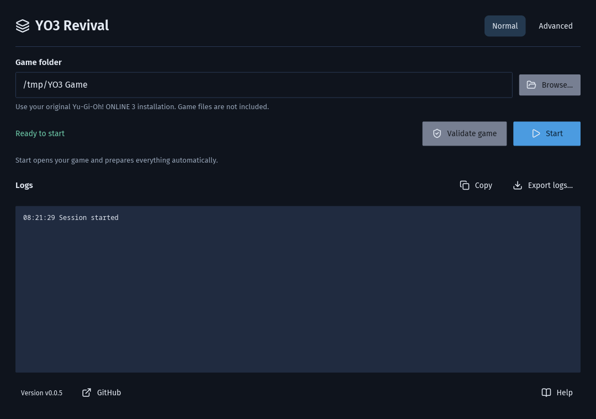
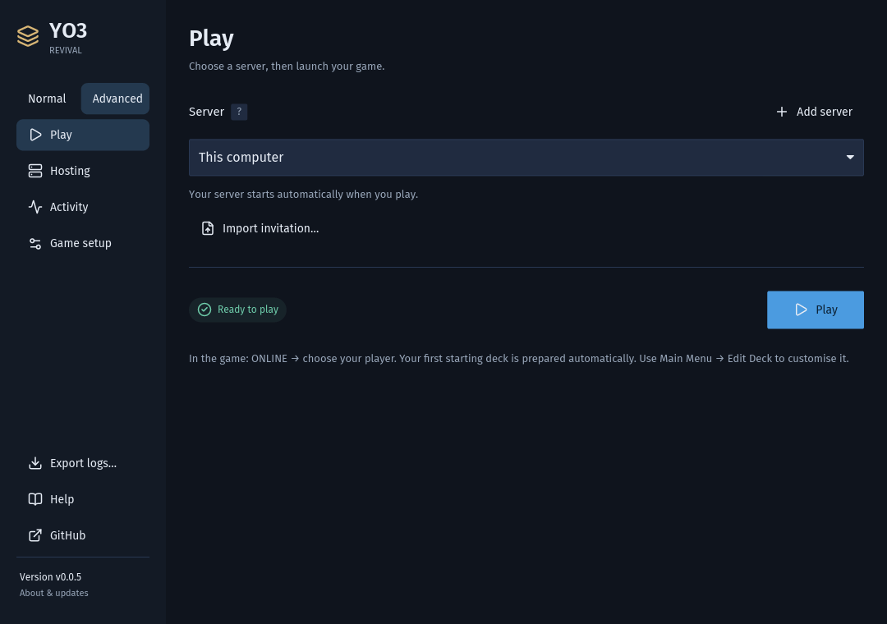
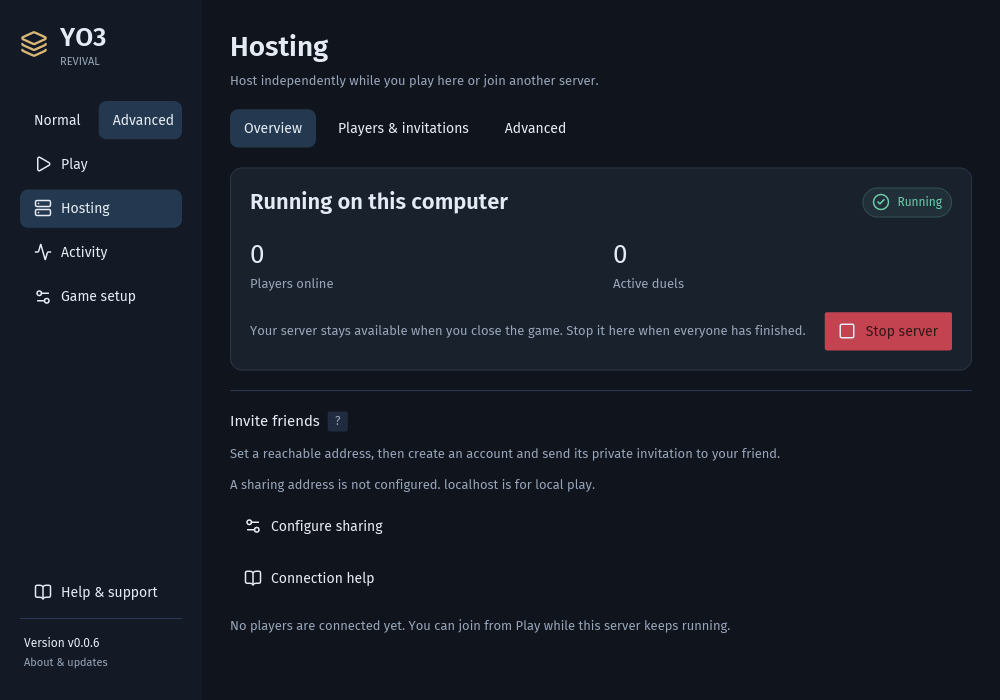

# Desktop guide

Use **Desktop** for a window with game setup, a Play button and logs. Use [Scripts](scripts.md) if you prefer a terminal.
Both editions include the server, rules engine, Node.js and required connection components. Game files are separate.

- [Desktop guide](#desktop-guide)
  - [First launch](#first-launch)
  - [Play locally](#play-locally)
  - [Join another server](#join-another-server)
  - [Host friends](#host-friends)
  - [Connection help](#connection-help)
  - [Open the game directly](#open-the-game-directly)
  - [Logs and support](#logs-and-support)
  - [Application updates](#application-updates)
  - [Your data and upgrades](#your-data-and-upgrades)
  - [Reset local game data](#reset-local-game-data)
  - [Reading the logs](#reading-the-logs)
  - [Troubleshooting](#troubleshooting)
  - [Getting the original game](#getting-the-original-game)

## First launch

You need a complete original **Yu-Gi-Oh! ONLINE 3 v1.153** installation and **64-bit Windows 10/11** or **Linux with Wine**.
**Windows 7 is not supported in either Desktop or Scripts; compatibility work is out of scope for now.**
macOS does not have a supported build. [Game installation help](#getting-the-original-game).

1. [Download the latest release](https://github.com/usersina/yo3-revival/releases/latest). Choose the **Desktop**
   archive for your system and extract **all** of it.
2. Open `yo3-revival.exe` on Windows or `yo3-revival` on Linux inside `yo3-revival-desktop/`.
   On Windows, look for the Duel Disk icon with the Monster Reborn badge.
3. Stay in **Normal** mode. Click **Browse…** and select the original game folder containing `yo3.exe`, `yo3.idx`
   and `package/`. Select the installed folder, not a shortcut, installer or the extracted Revival folder.
4. Wait for the automatic check, then click **Play**. A folder is saved only after its checks pass.
5. In the game, choose **ONLINE**, then select your player. [Start your first duel](playing.md#your-first-duel).

Choosing or pasting a folder checks the game, its legacy runtime, matching connection helper/DLL and the components
needed for your saved connection. These checks also run when the app opens and when the game folder or Wine prefix
changes. Pasted paths are checked after a short pause; a result for an older path cannot approve a newer one.
Only a successfully checked setup is saved. **Play** rechecks required files before opening the game and loads the
connection mod automatically; it does not change `yo3.exe` or `yo3.ini`.
Local play also verifies the bundled server, Node.js and critical engine files, then checks that the engine can load
without starting a duel. These checks run before Play even when the local server is already running.

The main button stays in one place: **Checking… → Play → Starting…**, or **Retry check** after a failed check.
Animated dots and nearby status text explain progress and why a button is unavailable. A game-folder problem appears
beside that field; **Use saved folder**, when available, restores your previous setup without saving the invalid path.

If Browse does not open a usable file dialog, choose **Use path instead** and paste the folder path into the box.
Close any remaining file dialog; its late selection will be ignored. A failure shows a short title and a compact
preview of its actual cause, including the affected filename, failure stage and Windows/native code when available.
Background checks keep the original startup failure visible. The copy icon beside the error copies its full report;
full diagnostics are also saved in the logs. Missing-file errors show the exact paths and a direct **Download Desktop…**
action. **Export logs…** stays above the logs, and copied errors and exported logs include the complete file list.
Restore missing Revival files from the complete matching Desktop
download, then choose **Retry check**. If antivirus removed
them, restore the files and exclude the affected Revival or game folder from scans; choosing another game folder
does not restore application files.

**Normal** is one screen: game folder, Play and logs. **Advanced**, at the top right, adds the
**Play**, **Hosting**, **Activity** and **Game setup** pages. Switching modes preserves saved settings and drafts.
Game and Wine settings are checked and saved automatically in either mode; Wine controls appear only on Linux.
Hosting settings still use **Save changes**.

Throughout the app, icons and text accompany status colors: **blue** for checks and information, **green** for success,
**amber** for warnings and **red** for errors. Field errors sit beside the affected setting; broader failures show a
notice with details and recovery actions.

## Play locally

On a new setup, **Play** prepares your local account and starts everything needed automatically. You do not need
a sharing address, an invitation, firewall changes, Rust or a separate Node.js installation to play on your own PC.
There is no project-operated public server.

Animated dots and the logs show startup activity. Wine can take about 30 seconds on a cold start. **Close game**
ends the managed game session and can cancel its initialization once that button is available. Errors stay visible
until dismissed or another action replaces them; [troubleshooting](#troubleshooting) explains the recovery controls.

Your first legal starting deck is prepared and selected once, without opening Edit Deck. Existing decks and all later
manual edits or deletions are preserved. See [the playing guide](playing.md) for computer opponents, friends and decks.

Closing the game leaves your local server available while the app stays open. Closing the app in Normal mode asks
for confirmation and stops its managed game and local server. In Advanced, leave **Keep hosting after I close Revival**
selected and click **Close app** to leave the server running; clear it to stop hosting too.

## Join another server

Ask the host for your **private invitation file**. Each friend needs their own account.

1. Switch to **Advanced → Play**.
2. Choose **Add server → Import invitation…** and select the file. The server identity, compatibility and account
   are checked automatically. Wait for **Invitation verified**, review the connection and click **Save connection**.
3. Select it in the **Server** dropdown. **Test connection** can check a saved connection again when needed.
4. Click **Play** in either mode.

Switching back to Normal keeps this connection. To play on your own server again, choose **This computer** in
Advanced → Play. Close the game before changing its server or account. The account selected on Play is independent
of the account being managed under Hosting.

A host can instead provide an address and account key. On **Advanced → Play → Add server**, enter the DNS name or
IP, optionally with a port (default **7443**), then click **Check server**. Compare the identity code with the host,
choose **Trust this server**, enter the private key and **Save connection**. You do not need to handle certificates
manually. The account is checked before the connection is saved. `yo3://host:port` addresses are also accepted.
Later connections verify the saved identity automatically.

If an imported invitation cannot be verified, read the error and choose **Retry check** once the host is available.
Changing its address requires **Check server** and explicit identity confirmation again before the account check.

CLI profiles can also be imported if their public certificate is beside them. **Edit server** changes a saved connection;
changing the address requires checking its identity again. **Edit server → Remove connection** deletes it locally, leaving
the account and game data on the host. Never post invitations or account keys in a bug report.

## Host friends

Hosting and playing are independent: you can host without opening a game, or host while playing on another server.

1. Switch to **Advanced → Hosting → Advanced**. If your local server is running, close its game and choose
   **Overview → Stop server** before changing hosting settings.
2. Set **Sharing address** to the LAN/VPN address or hostname your friends can reach. Leave **Listen on** at
   **All interfaces (0.0.0.0)** unless you need a specific interface. Click **Save changes**. Until a sharing address
   is saved, **All interfaces** accepts only this computer, so playing alone opens no network port.
3. Under **Overview**, click **Start server**.
4. Open **Players & invitations → New account** (or **Create account** if there are no accounts yet). Enter a unique
   first-player name, **1–16 characters**, and click **Create account**.
5. Select that account and click **Export invitation…**. Send the saved file only to that friend.
6. They follow [Join another server](#join-another-server). Repeat account creation for each friend.

The default public port is **TCP 7443**. Friends connecting from outside your PC need network access to it; see
[Connection help](#connection-help). **Start server** does not request administrator access or change firewall rules.
**Running on this computer** confirms local status, not reachability from a friend's network.

**Players & invitations → Additional players** adds players to the selected account, up to four total. Players choose
their slot inside the game. Re-export an account's invitation when needed; managing it does not switch your login on Play.

**Players & invitations → Give BP** adds BOOSTERPASS Points to the selected account while the server runs, including
your own account when you play locally. A game that is open shows the new total on its next screen. BP earned in
duels appears the same way.

**Players & invitations → BOOSTERPASS codes** makes codes players type in the game (Main Menu → BOOSTERPASS) for BP,
once per account. Leave **Code** empty for a random one, and **Accounts** empty to let any number of accounts claim
it. Each code lists who claimed it and when; **Copy** puts it on the clipboard and **Remove** retires it (BP already
claimed stays).
Do not edit `accounts.json` for this: the server stores accounts in `server.db` and ignores that file after upgrading.

Under **Hosting → Advanced**, you can choose an interface, change the port/data folder and set the first player for
a new server. A saved interface follows address changes; an unavailable interface reports an error rather than
opening access on every interface. Stop the server before saving hosting changes.

**All server flags** is searchable and comes from the actual server CLI, including `--duel-check` and future run flags.
Enter values directly, not shell commands. **Use default** removes an override. Settings owned by another control point to
that control; log paths stay app-managed. Use the [Scripts edition](scripts.md) for fully manual paths.

## Connection help

Check the saved sharing address/port, whether the host is running, and whether that address is reachable from the
friend's computer. Localhost only reaches the same PC; `0.0.0.0` is a listening setting, not an address to send friends.
An explicit external port in the sharing address can match a router/VPN mapping.

Only the chosen **TLS port** needs to be reachable by players. The internal HTTP/admin listener stays on loopback;
do not forward it. The DLL supplies private local game ports automatically. You do not need to edit `yo3.ini` or
forward the old game ports. A timeout alone does not identify a firewall or router as the cause.

Manage firewall access in the operating system and router/VPN routing outside the app. On Windows, if an earlier
version asked whether to allow `yo3-server.exe` and you chose **Cancel**, Windows saved a rule that blocks it: friends
then cannot connect until you allow `yo3-server.exe` in Windows Defender Firewall (**Allow an app through firewall**). See the official
[Windows firewall tools](https://learn.microsoft.com/windows/security/operating-system-security/network-security/windows-firewall/tools)
or [firewalld port/service guide](https://firewalld.org/documentation/howto/open-a-port-or-service) if applicable.
An application-specific firewall allowance may need updating after an executable path changes.

The app maintains its self-managed certificate at startup while preserving the server's identity key. Normal joining
uses an invitation or remembered identity; it does not require copying certificates. Confirm unexpected identity
changes with the host. [Authentication details](authentication.md) and [CLI network settings](guide.md#network-settings)
are available for advanced setups.

## Open the game directly

This is optional. First let the game-folder check finish and select the server/account on Advanced → Play. Then open
**Advanced → Game setup → Advanced game options** and check **Allow opening yo3.exe directly**. If using your local
server, start it in Hosting first; the checkbox explains when setup or a running game prevents a change.
You can then open the original `yo3.exe` or its shortcut; direct launch uses the saved connection and does not start
a stopped server for you.

The setup adds an owned `winmm.dll` loader and receipt beside the game, leaving the executable and INI unchanged.
Credentials stay in private app storage. A protected game folder may request permission for this explicit setup or
removal. It refuses to replace another mod.

Clear the checkbox to remove that setup. **Repair direct launch** appears when owned components need refreshing;
it restores the bundled `winmm.dll` beside `yo3.exe` and refreshes the saved server/account. The checkbox stays checked
with **Needs repair** until repaired or turned off. Removal remains available even when
required Revival files are missing. Turn it off before moving the saved game location or changing the Wine prefix.
Status shows Enabled, Disabled, Needs repair or Mod conflict; another mod is never overwritten.

The loader checks required components and server compatibility before login. A missing DLL gives its expected path
and offers a matching-file picker, followed by restart. A game with no loader at all can only show the original
generic connection failure: the remote server cannot inspect files on your PC. Use the Desktop app to set it up.

## Logs and support

Normal mode always shows logs below Play, with **Export logs…** in the log header. **Help & support → Copy logs**
is also available during startup. Advanced → **Activity** separates
**Server** and **Game & launcher** logs, with filtering and pause controls. Startup output is captured even if a helper
fails before opening its own log session. Game stdout/stderr, DLL diagnostics, decoded server packets (including
nested fields) and engine stderr are captured automatically; there is no tracing checkbox to enable beforehand.
The ordinary view hides verbose payloads. Search **YO3 CLIENT**, **YO3 PACKET** or **YO3 ENGINE** in Activity to see
those retained traces, or export them.
Log panels fit short output and scroll when full. Normal mode caps their height, groups repeated lines and hides
Wine `fixme` diagnostics with an omission count.
Errors remain visible. Advanced Activity keeps the technical output; exports retain the original logs, including
grouped repeats and hidden Wine diagnostics.

Logs open at the newest line, with the scrollbar on the right. New output follows while you are at the bottom.
Scroll up to read older lines without being pulled down; scroll back to the bottom to resume following.

To report a bug:

1. Open **Help & support → Report a problem…** (also available beside an error).
2. Describe what happened. Extra detail is optional when an error was captured; **Steps to reproduce** is optional too.
3. Choose **Sign in to GitHub**, enter the displayed code in your browser and approve **YO3 Revival Reports**.
   Signing in does not publish anything. Sign-in is remembered in your system's secure credential store when available.
4. Review the report. Version, OS/build, Wine version when used, captured errors, missing files and current-session
   logs are included automatically. **Diagnostic options** selects current or all retained sessions.
5. Choose **Publish bug report**. Desktop uploads text diagnostics to an unlisted Gist in your GitHub account,
   then creates the issue with a link to those logs. **View issue** opens it; you can add screenshots or a video there.

**The issue is public, and anyone with its diagnostic link can read the logs.** Full reports can contain player
names, chat, decks, file paths and network addresses. The smaller **Exclude chat, decks, paths & addresses** checkbox
omits player activity and detailed client/packet/engine traces, and masks common paths, IP/email addresses and server
URLs in the report. This reduces debugging detail and is best-effort filtering; review before sharing. The original
logs stay unchanged. Credentials, databases, private profiles and game files are excluded regardless of that option.

If posting fails, the error stays in the dialog and the original game error stays visible. Retries reuse uploaded
logs. **Check report status** checks an uncertain earlier request before another post, including after reopening
Desktop. Oversized evidence is rejected before upload; choose current-session logs or filtering, or export a ZIP.
**Copy report**, **Export logs…** and **Copy link** appear as recovery options when needed. Never share private
invitations, account keys or `server.key`.

To save logs locally instead, use **Export logs…**, select current or retained sessions, then **Save ZIP…**.
That action does not upload anything. A ZIP can be attached to [a manual GitHub report](https://github.com/usersina/yo3-revival/issues/new/choose).

For a duel bug that needs state validation and exact replay, enable **Advanced → Hosting → Advanced → All server
flags → --duel-check**, save and restart the hosted server between games. Ask both players to collect matching logs.
This extra checking remains optional because it adds engine queries and a potentially slow dependency scan. Automatic
logging does not enable it. Disable the flag when the investigation is finished.
[Developer replay and validation](development.md#duel-diagnostics) explains the automated checks.

Logs rotate at 2 MiB and are retained for up to 14 days or 100 MiB, protecting active logs. The viewer reads a bounded
tail. Current-session exports include this app, its attached server and latest game run; all-session exports also
include retained history. Reports exclude credentials, databases and game files, and omit developer packet logs
outside the indexed session directory. Decoded packet traces are inside the session logs even when separate raw
packet files are disabled. Oversized lines/payloads are bounded; this is diagnostic capture, not a full memory dump.
Original game stdout from optional direct launch is not redirected into the helper's session; reproduce through
Desktop **Play** or Scripts **play** when that trace is needed. A remote player's export cannot include the host's
server logs: the host must export those separately.

## Application updates

Click the version for **About & updates**, including **GitHub** and **Copy version**. Startup checks leave play
available when offline or rate-limited. A failed check offers **Try again** or **Open releases**. If no compatible
Desktop download is found, use **Open release downloads** to check the available builds.

For a newer compatible Desktop release, choose **Review & install…**, read the notes and confirm **Download & restart**.
The formatted notes scroll separately, keeping the restart warning and confirmation buttons visible. Links open in
your browser; the notes are also on [GitHub Releases](https://github.com/usersina/yo3-revival/releases).
You can cancel while downloading. The app verifies the download and component manifest before activation.
Finish duels first: the managed game closes and restarting hosting disconnects its players. Settings, accounts and
server data remain in place. Press **Play** yourself to reopen the game afterwards.

If verification or the new app's startup fails, the previous version remains available. Existing launcher shortcuts
route to the active version; keep the original bundle if using its shortcut or an older direct-launch setup.
Updates live under `updates/installs/` in private app storage, with the active/previous selections in `launcher.db`.
Direct launch may need **Repair direct launch** after an update. Development builds stay in place.

Archives have versioned filenames, but stable inner folders: `yo3-revival-desktop/` and `yo3-revival-scripts/`.
Do not overwrite a running bundle. [Scripts updates](scripts.md#updates) are manual.

## Your data and upgrades

App storage defaults to `%LOCALAPPDATA%\YO3 Revival` on Windows and
`${XDG_DATA_HOME:-~/.local/share}/yo3-revival` on Linux. Open it through
the version → **About & updates → Open application data**.

| Location inside app storage              | Contents                                                              |
| ---------------------------------------- | --------------------------------------------------------------------- |
| `launcher.db`                            | Preferences and saved private connections                             |
| `server/server.db`                       | Server state: accounts, cards, decks, BP, codes, mail, duel logs      |
| `server/server.crt`, `server/server.key` | Public certificate and private server identity key                    |
| `logs/`, `profiles/`                     | Diagnostics and private connection profiles                           |
| `reports/bug-reports.db`                 | Sanitized report drafts and posting receipts for safe retries          |

To reuse an existing server, **stop it and back up its entire data folder first**. Set that folder under
**Advanced → Hosting → Advanced → Data folder**, save, then start hosting. Changing the path selects data; it does
not move existing data. The default is the app's `server/` directory; the page shows the folder in use.

**Coming from the Scripts edition?** Desktop does not use a Scripts bundle's `data/` folder on its own. Stop the
Scripts server (`run.cmd` / `run.sh`), then choose that `data/` folder as the Data folder above to keep its
accounts, cards, BP and invitations. If you start Desktop while the Scripts server still runs on the same port,
Start reports that the port is taken.

Old JSON state imports into SQLite in one transaction. Account/player IDs and credentials are preserved. Original
JSON files remain as migration copies and no longer receive writes; edits to them after the upgrade are ignored
(the server log says so). Give BP and the other Hosting controls change the database. A failed import reports an error; repair its
source before retrying. Do not remove a migrated database to try to reimport stale JSON.

Each server startup creates a consistent database backup under the server data folder's `backups/`. These backups
exclude the identity key: separately back up the **whole data folder** securely. Players should also back up their
local `Documents/Yu-Gi-Oh! ONLINE 3` folder, which holds editor-only deck saves.

Restore only with the server stopped. Older releases cannot read the current SQLite state; downgrading requires
the original pre-upgrade snapshot and loses later database-only changes. Do not downgrade by copying back the old JSON.

## Reset local game data

For broken game preferences or saved stock login details, close every game window and choose
**Help & support → Reset local game data…** in either mode. Review the displayed local data folder, then choose
**Back up & reset**.

**Keep player files and saved decks** is selected by default. This resets game options and cached stock logins
while keeping all player files, saved decks, deck selection and starter setup markers. Clear it only for a full
local reset: the entire client folder moves into the backup, and the game creates fresh local files next launch.
Server accounts, cards and BP, and your saved Revival connections stay in place.

Use **Open backup folder** afterward. Dated backups live in `.yo3-revival-backups/` beside the game's local data
folder in Documents; a full backup contains the original folder as `data/`. Windows Documents redirection and the
selected Wine prefix are respected. Wine prefixes can share this folder, so close games in other prefixes too.

To restore, close the game and move newly created files aside first. For a full reset, move the backup's `data/`
folder back to the displayed original location; for the default reset, move `options.y3o` and `users/` back from
the backup. Keep backups private: they can contain personal files and cached stock login details.

## Reading the logs

Logs show each line's level: **errors in red** and **warnings in amber**; other lines are information. The same
levels appear in a terminal running the server (Scripts), coloured unless `NO_COLOR` is set; saved and exported
logs stay plain text. A warning about old `accounts.json` (or other `.json`) copies is safe to act on: after an
upgrade their data lives in `server.db`, the files are no longer read, and you can delete them.

## Troubleshooting

| Problem                                      | What to do                                                                                                                                                                                                                                               |
| -------------------------------------------- | -------------------------------------------------------------------------------------------------------------------------------------------------------------------------------------------------------------------------------------------------------- |
| Downloaded Revival but have no game          | [Install the original game separately](#getting-the-original-game), then choose its installed folder.                                                                                                                                                    |
| Browse does not open a dialog                | Choose **Use path instead**, close any remaining dialog and paste the game folder path.                                                                                                                                                                  |
| Play is unavailable                          | Choose the game folder and wait for its automatic check. Read the nearby status or field error; use **Retry check** after fixing the cause, or **Use saved folder** to return to your previous setup.                                                       |
| Incomplete game                              | Select the full installation containing `yo3.exe`, `yo3.idx` and `package/`, not an installer or shortcut.                                                                                                                                               |
| Unsupported game executable                  | Use the original **v1.153** installation. Validation checks the hook signatures before startup; replacing Revival helpers cannot fix a different game build.                                                                                             |
| Missing DirectX or VC90 runtime              | Follow [original game runtime repair](guide.md#original-game-runtimes), then choose **Retry check**. The error identifies the dependency or runtime manifest.                                                                                           |
| Revival helper/DLL or engine missing         | Re-extract the complete matching Desktop archive, keeping every helper and `engine/`. A different game folder will not repair app files.                                                                                                                 |
| Antivirus flags Revival / a file disappeared | Check protection history and the official download. For a verified false positive, allow the affected file or exclude only the extracted Desktop folder. [Exact files, folders and recovery steps](guide.md#windows-smartscreen-and-antivirus-warnings). |
| App settings/logs cannot open                | Check the data folder's permissions/free space, then **Retry app setup**. Copy the error if it continues; keep your saved data.                                                                                                                          |
| Game startup fails or stalls                 | Read the visible error and logs. Use **Close game** when available, then try **Play** again; export logs if it repeats.                                                                                                                                 |
| Old game preferences or saved login details  | Try [Reset local game data](#reset-local-game-data), keeping player files and decks selected first. Review the target and backup before confirming.                                                                                                        |
| DLL did not initialize / unexpected EOF      | Current builds include the native failure stage and Windows error/exit code in details and logs. Keep those details when reporting; an EOF alone does not identify the cause.                                                                            |
| Intermittent discovery/login reset (10054)   | Update both Desktop/Scripts and the host's server. A response-cleanup bug was reproduced on Windows 11. If it continues, export logs from the failed attempt; a native `0xc0000005` game crash needs separate investigation.                                  |
| Trunk shows no cards                         | Clear the editor's filters and check server logs. The host must load complete game card/deck data; current builds refuse hosting if that fails. Correct the host's game folder and restart, keeping all account/deck data.                               |
| Cannot connect to a friend                   | Confirm the selected connection in **Advanced → Play**, then **Test connection**. Check [network access](#connection-help).                                                                                                                              |
| Identity or authentication refused           | Confirm identity changes with the host, or import the correct invitation for this server/account.                                                                                                                                                        |
| Cannot save a diagnostic ZIP                 | Check the error in the export dialog, choose a writable folder and retry. Copy logs/error as a fallback.                                                                                                                                                 |
| A long session disconnects                   | Sessions last 12 hours. Close the game and start it again.                                                                                                                                                                                               |
| A duel ends immediately as a draw            | Check server logs for **DUELS WON'T WORK** and restore the complete bundled engine. Source builds need the [engine dependencies](development.md#build-from-source).                                                                                      |
| A card seems to behave incorrectly           | Check [card rules](playing.md#card-effects-and-summon-rules), then [record the duel](#logs-and-support) if needed.                                                                                                                                       |
| Windows 7                                    | The current release requires a supported modern OS, even if the original game itself runs there.                                                                                                                                                         |

On minimal Debian/Ubuntu X11 systems, install Desktop's runtime libraries with
`sudo apt install libxcursor1 libx11-xcb1 libxi6 libxkbcommon-x11-0`. Missing-library errors prevent the app from
opening its window.

These executables and the injector/DLL are unsigned. [Windows warnings](guide.md#windows-smartscreen-and-antivirus-warnings)
explains what to check. Native Windows 11 checks cover standard-user startup in a writable game copy, Desktop and
Scripts hosting/play, starter setup, a complete NPC duel, log export and updater activation. Windows 10, protected-folder
direct-start installation and runtime reinstallation still need native checks. For terminal errors, see
[Scripts troubleshooting](scripts.md#when-something-fails).

## Getting the original game

Revival does not download or distribute the original game. Use a complete **v1.153** installation you are entitled
to use. A third-party archive reference is the
[MyAbandonware game listing](https://www.myabandonware.com/game/yu-gi-oh-online-3-duel-accelerator-qy4).
This link is a reference, not a Revival download or a guarantee about that archive.

A typical installed folder contains `yo3.exe`, `yo3.idx` and `package/`. On Windows it is often under
`C:\Program Files (x86)\Konami\Yu-Gi-Oh! ONLINE 3`; on Linux it is often inside your Wine prefix's `drive_c`.
Keep the original game's folder separate from the extracted `yo3-revival-desktop/` folder.
