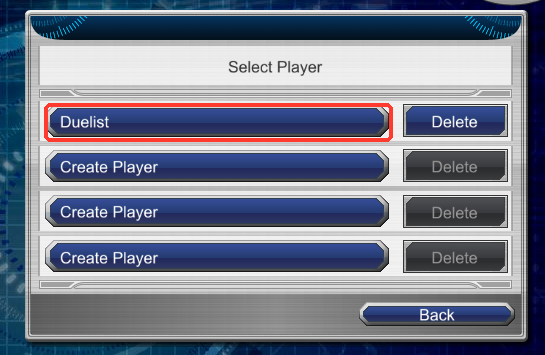
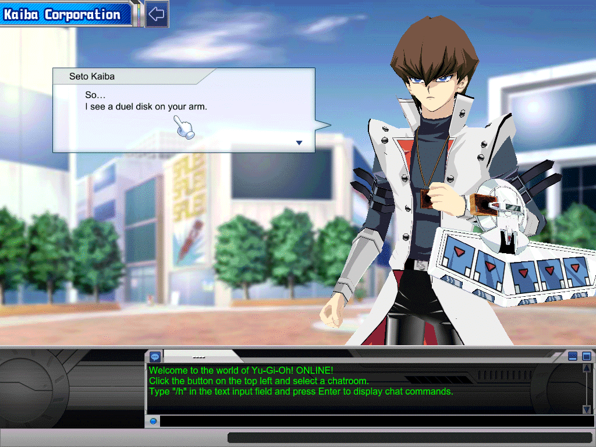
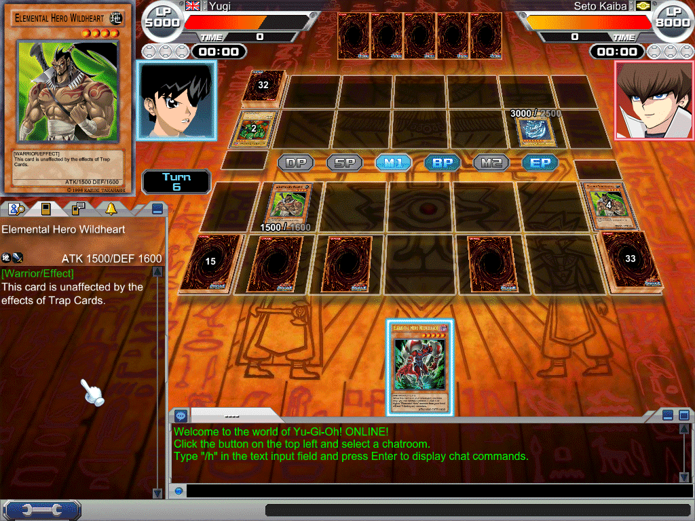
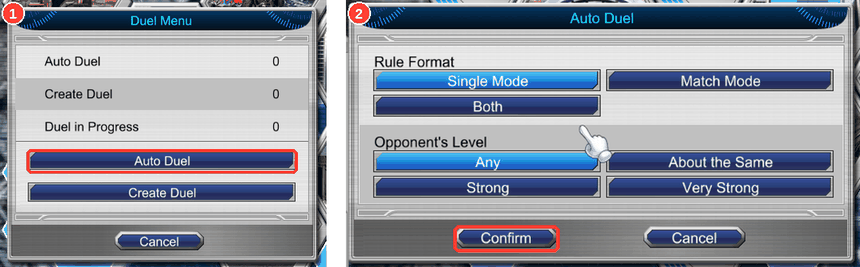
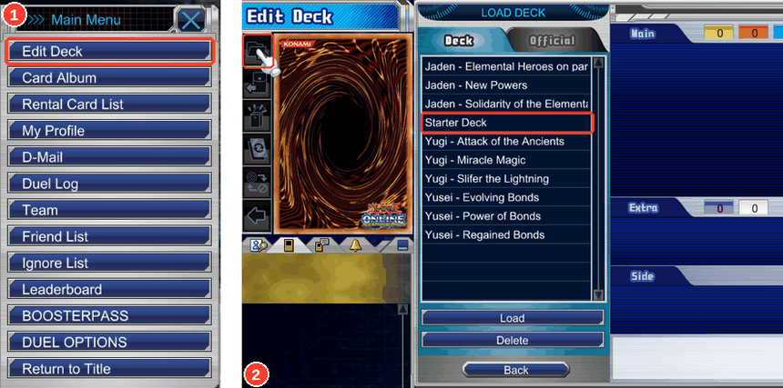
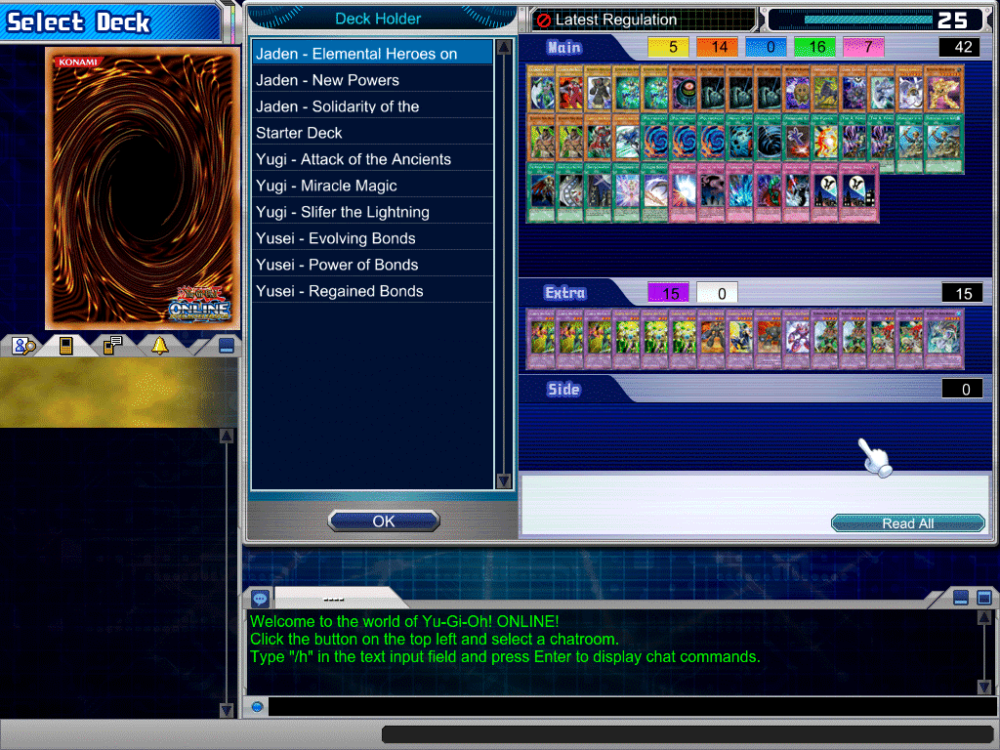

# Playing guide

First set up [Desktop](launcher.md#first-launch) or the [Scripts edition](scripts.md). Both launch the same original
game with the same connection DLL and rules engine.

- [Enter the game](#enter-the-game)
- [Your first duel](#your-first-duel)
- [Play with a friend](#play-with-a-friend)
- [Choose or edit a deck](#choose-or-edit-a-deck)
- [Card effects and summon rules](#card-effects-and-summon-rules)
- [Features and limitations](#features-and-limitations)

## Enter the game

Press **Start** in Normal mode, or **Play** on Advanced → Play. Once the game opens, choose **ONLINE** and select
your player. The connection app already authenticated you; there is no original username/password form to fill in.
A new account's first player is in the first slot.

## Your first duel

1. On the map, click **Kaiba Corporation**, the tall blue building.
2. Click through the conversation and accept the duel.
3. Choose a deck and confirm it, then play rock–paper–scissors to decide who goes first.

Your first starting deck is prepared and selected automatically. You can duel without opening Edit Deck.

In a duel, left-click a hand card for its default action; right-click it for the available actions.
Use the phase buttons to enter the Battle Phase, Main Phase 2 or End Phase.

## Play with a friend

First [join the same server](launcher.md#join-another-server). Each friend needs a separate account from the host.

- **Auto Duel:** both open the duel menu, choose **Auto Duel → Confirm**, then confirm their decks. Wait to be matched.
- **Pick a specific opponent:** one player uses **Create Duel**. The other opens that player's **Player Information**
  and chooses **Send Duel Request**. Confirm the request, choose decks and play.

The chosen banlist applies to Create Duel. The host controls the default banlist used for Auto Duel and computer duels.

## Choose or edit a deck

Open **Main Menu → Edit Deck** to customise your cards, use another official character deck or make a side deck.
Drag a card after briefly hovering it. The Yugi, Jaden and Yusei character decks are available.

Automatic starting-deck setup runs once for a fresh player profile. Existing decks and selections are kept,
including unfinished decks and any later edits or deletions. It will not recreate a deck you deliberately removed.

Editor saves live in your local `Documents/Yu-Gi-Oh! ONLINE 3` folder. Selecting a deck for a duel also uploads it to
the server; saving in Edit Deck alone does not make that deck available on another computer. Back up the local folder.

## Card effects and summon rules

Battle protection can apply without a confirmation dialog. Fortress Warrior survives its first battle destruction
each turn and stays on the field. Debris Dragon cannot use another Level 4 monster as Synchro Material:
Debris Dragon + Max Warrior cannot summon Stardust Dragon. Debris Dragon + Fortress Warrior + Quillbolt Hedgehog
is a legal Level 8 combination. See the official [Fortress Warrior](https://www.db.yugioh-card.com/yugiohdb/card_search.action?cid=7985&ope=2)
and [Debris Dragon](https://www.db.yugioh-card.com/yugiohdb/card_search.action?cid=8005&ope=2) card text.

If a protected monster disappears, a slot appears empty but remains occupied, or a legal action fails, follow
[duel bug reporting](launcher.md#logs-and-support). Include the card names and the exact steps.

## Features and limitations

The main playable features are:

- **Duels:** NPC opponents, Auto Duel, Create Duel, Single and Match Mode, spectating, and the client's choice dialogs
  and animations.
- **Cards and decks:** Edit Deck, official character decks, booster packs, structure decks, trading and rentals.
- **Community:** chat rooms, whispers, player search, friends, D-Mail, teams and player-run knockout tournaments.
- **Customization:** avatar settings, card protectors and avatar items bought in the shop.

Each account starts with **5000 BOOSTERPASS Points**. Packs cost 100 BP; duels earn 100 for a win, 50 for a draw and
30 for a loss. The shop shows updated points after your next login or purchase. The host can also issue codes,
redeemed through **Main Menu → BOOSTERPASS**. Purchased cards stay on the server; a bought structure deck appears
in Edit Deck's deck list.

Duels between players have clocks: 3 minutes a turn and 10 minutes a duel (or the host's choice in Create Duel), and
running out loses the duel.

Control changes preserve a monster's counters and current stats. For example, Breaker keeps its Spell Counter
and boosted ATK when Snatch Steal changes its controller.

To add a friend, open their Player Information (click them in player search) and press Send Friend Request; they
get a friends icon at the top left, and accepting adds you to each other's lists. Main Menu → Friend List shows all your
friends; the search tab's two-people button shows the ones who are online. Friends are kept by the host's server.
In Create Duel, Opponent's Limits → Friend lets only your friends send you a duel request.

Main Menu → D-Mail sends a friend a message (Write Mail, then the friends button to pick them); they see a mail icon
at the top left, or get it at their next login if they were away.

Main Menu → Team forms a team; its leader invites players from their Player Information. A team has its own chat tab
and D-Mail (Send to Team), and Create Duel's Opponent's Limits → Team takes requests only from your team.

Satellite Plaza holds user events: Create User Event makes a knockout tournament, friends press Participate in its
details, and the host starts it from the duel button's Event Menu in the lobby; the server pairs everyone and each
pair duels, round by round, until one is left.

You can watch a friend's duel: find them in player search (they show as duelling), open Player Information and press
Watch Duel. You see the duel from one player's side with both hands hidden, and go back to the map when it's over.

In Match Mode, a player whose deck has a side deck gets the Card Swap screen between duels: drag cards between the
side deck and the main or extra deck, then press the arrow at the top left to go on. Build a side deck in Edit Deck.

The shop also sells card protectors (200 BP) and avatar items (100 BP): Avatar Settings and the deck editor offer
them once bought.

To trade cards, open a player's Player Information and press Send Trade Request; once they accept, drag cards from
your trunk into your half of the table, press Ready to Trade., and answer Yes to "Execute Trade?". A deck that used a
card you traded away no longer counts as valid until you edit it.
Changing either offer withdraws both players' approvals: both must press Ready to Trade. and confirm the new offer.
Existing accounts and accounts made through `add-account` can trade and rent cards too; their collection follows the player.

To lend cards, open a player's Player Information and press Send Rental Request. Once they accept, the lender sets the
conditions (a term of 1, 3, 7 or 14 days, and Free) and double-clicks cards from their trunk into the list, then presses
Confirm; the borrower answers "Borrow these cards?" and the cards join their trunk (marked as borrowed, so they can be
put in decks but not traded) while the lender's copies are out of theirs. When the term is over the cards are back with
their owner, even across a server restart (they are kept in the SQLite rentals document); there is no early return. Both players'
Main Menu → Rental Card List shows what they lent and borrowed. Editor saves live locally in
`Documents\Yu-Gi-Oh! ONLINE 3`; selecting a deck for a duel also uploads it to the server. A deck that used a borrowed
card is no longer valid once the rental ends.

Limitations: this is pre-alpha. Computer opponents use a basic bot, and saving in Edit Deck alone does not sync a
deck to another machine; select it for a duel to upload it. The client has its original card pool and UI. Some reply
fields remain inferred rather than confirmed against Konami's server; [the roadmap](roadmap.md) lists those choices
and the remaining live checks, including play from separate friends' machines with the new launcher.
