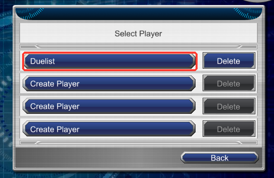
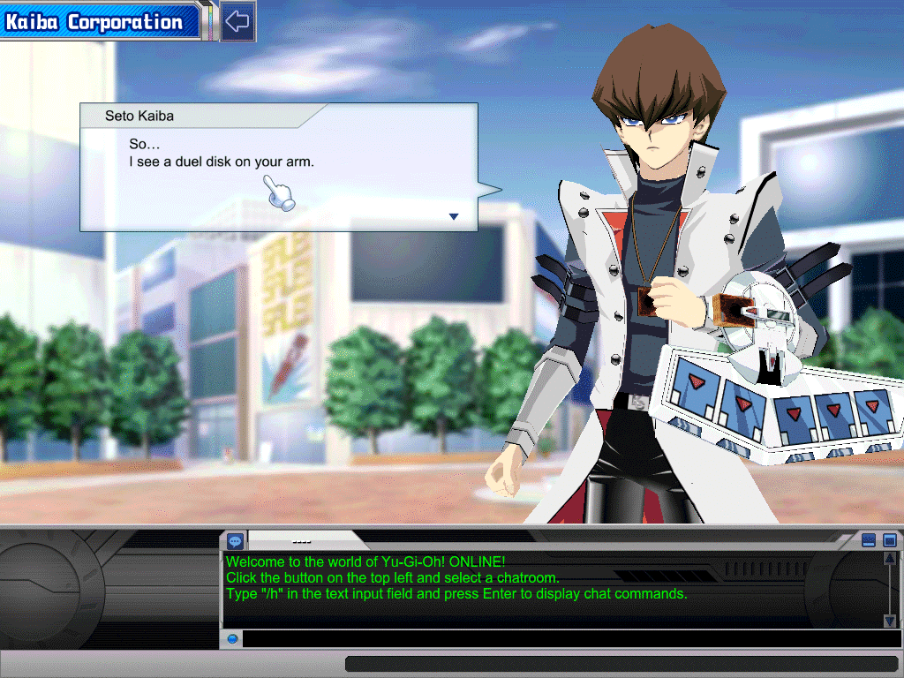
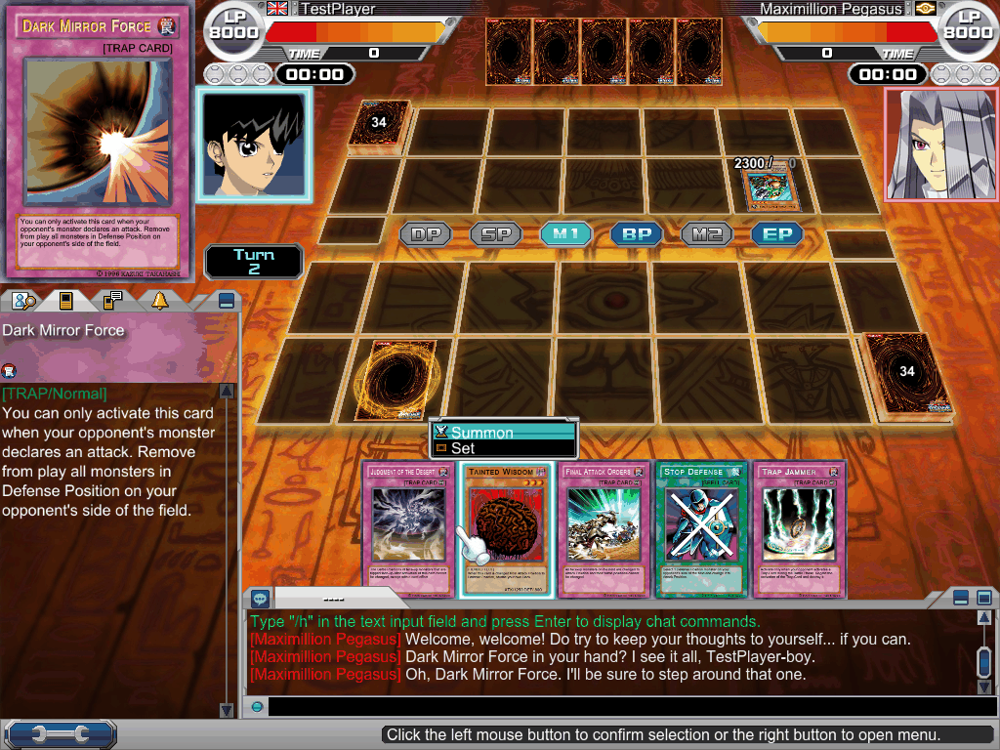
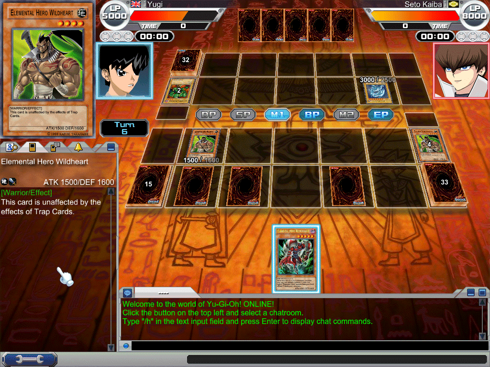
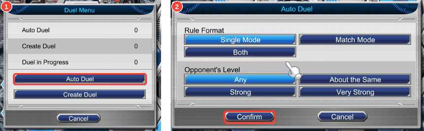
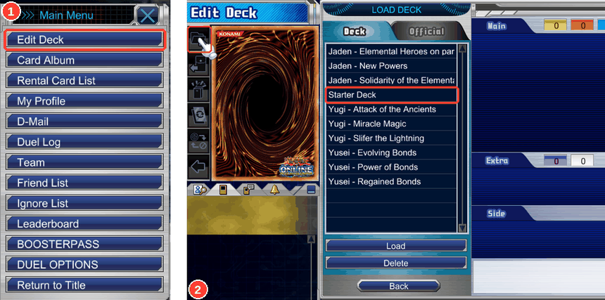
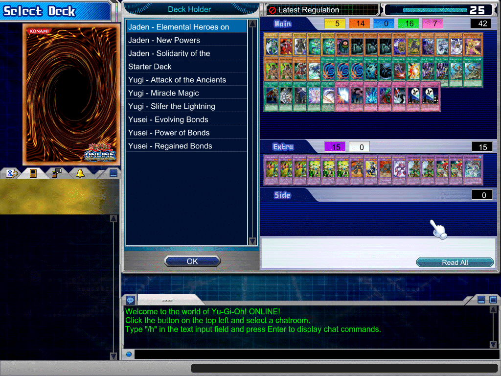
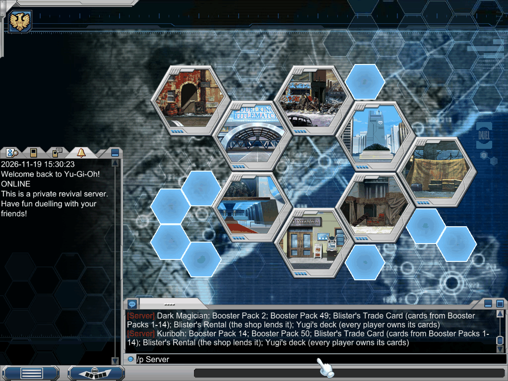

# Playing guide

First set up [Desktop](launcher.md#first-launch) or the [Scripts edition](scripts.md). Both launch the same original
game with the same connection DLL and rules engine.

- [Playing guide](#playing-guide)
  - [Enter the game](#enter-the-game)
  - [Your first duel](#your-first-duel)
  - [Play with a friend](#play-with-a-friend)
  - [Choose or edit a deck](#choose-or-edit-a-deck)
  - [Card effects and summon rules](#card-effects-and-summon-rules)
  - [Anime card versions](#anime-card-versions)
  - [Destiny Draw](#destiny-draw)
  - [Chatting](#chatting)
  - [Chat commands](#chat-commands)
  - [Features and limitations](#features-and-limitations)
    - [Website pages](#website-pages)

## Enter the game

Press **PLAY** in the launcher, on the Singleplayer or the Multiplayer tab. Once the game opens, choose **ONLINE** and
select your player. The launcher already signed you in; there is no original username/password form to fill in.
A new account's first player is in the first slot.

## Your first duel

1. On the map, click **Kaiba Corporation**, the tall blue building.
2. Click through the conversation and accept the duel.
3. Choose a deck and confirm it, then play rock–paper–scissors to decide who goes first.

Your first starting deck is prepared and selected automatically. You can duel without opening Edit Deck.

In a duel, left-click a hand card for its default action; right-click it for the available actions.
Use the phase buttons to enter the Battle Phase, Main Phase 2 or End Phase.
To attack a monster, click your attacker, then click the monster to attack: an arc aims at the monster under the pointer.
Right-click instead to take the attack back.
To give a duel up, click your own Deck pile (it doesn't light up) and choose **Surrender**, then Yes. From the fifth turn
on only; before it the game says so. A host can turn Surrender off in Create Duel. The Extra Deck lights up only when a
summon from it is possible; click it anyway to look through it (**See Details**).

**Main Menu → DUEL OPTIONS** sets how duels behave for you. With **Auto Card Placing** OFF you choose the zone for each
monster, Spell and Trap you put on the field (a prompt, then a click on a free zone); ON, the game picks for you.
**Activation Message** decides how often the game asks whether to activate a card. On the default (Semi Auto Cancel), it
always asks for effects used during a phase, such as Stardust Dragon returning in the End Phase.

Each NPC plays in character and talks in the chat window below the field, with its name in red. Yami Yugi, Yugi,
Jaden and Yusei draw the card they need, and Maximillion Pegasus can see your hand and your Set cards, unless you wear
a Millennium Eye of your own: Bakura's Accessories from the shop, worn as Facial Accessory 2 in Avatar Settings.

Every duel, against an NPC or a player, is saved as a duel log: Main Menu → Duel Log → Latest Duel Logs, then click it
and Play to watch it again (both players' cards are shown).

## Play with a friend

First [join the same server](launcher.md#join-another-server). Each friend makes their own account there, with an invite
code from the host.

- **Auto Duel:** both open the duel menu, choose **Auto Duel → Confirm**, then confirm their decks. Wait to be matched.
- **Pick a specific opponent:** one player uses **Create Duel**. The other opens that player's **Player Information**
  and chooses **Send Duel Request**. Confirm the request, choose decks and play.

The chosen banlist applies to Create Duel. The banlist used for Auto Duel and computer duels is the one you log in
with: the host's (**Season 16** unless they chose another; **Unlimited** on your own Singleplayer server) until you pick
your own with [`banlist` in the chat](#chat-commands). The Yugi, Jaden and Yusei character decks hold cards Season 16 forbids or
limits (Heavy Storm, Premature Burial...), so either edit them or choose `unlimited` (or another list that allows
them) and log in again; your starter deck is fine. Auto Duel only matches players on the same banlist, so nobody
brings a deck the other's list forbids.

**Two accounts on one PC.** Your launcher can run a second game as another account
([Play as another account](launcher.md#several-games-at-once)), for example to duel a friend who plays on the same computer.
Accounts seen on the same PC or network are *linked*: a duel between them is played, but **pays no BP and counts no record,
rating or title**, and they can't trade or rent to each other (the game says why in your chat). The host can turn that off
or let a PC run more games.

## Choose or edit a deck

Open **Main Menu → Edit Deck** to customise your cards, use another official character deck or make a side deck.
Drag a card after briefly hovering it. The Yugi, Jaden and Yusei character decks, your starter deck's original recipe
and the structure decks you bought are under **Load Deck → Official**: load one, then save it (Save → New) to make it
one of your decks and use it in duels. The **Deck** tab holds your own decks. Deleting your Starter Deck there is for
good; its recipe stays under **Official** if you want it back.

Automatic starting-deck setup runs once for a fresh player profile. Existing decks and selections are kept,
including unfinished decks and any later edits or deletions. It will not recreate a deck you deliberately removed.

Editor saves live in your local `Documents/Yu-Gi-Oh! ONLINE 3` folder, and saving in Edit Deck (or selecting a deck
for a duel) also sends the deck to the server. When you play from another computer, Edit Deck → Load Deck lists it
there too. A computer that already has a deck of that name keeps its own copy, so give a changed deck a new name (New)
if the other computer has the old one. The server keeps your ten most recent decks; back up the local folder.

Each server keeps its own local game data, so a player named "Duelist" on one server doesn't see another server's
"Duelist" decks. The first server you play on (since v0.0.12) keeps `Documents/Yu-Gi-Oh! ONLINE 3` and the decks
already there; every other server gets `Documents/YO3 Revival/servers/<server id>/Yu-Gi-Oh! ONLINE 3`, starting with
your display settings and a fresh starter deck. The folder's `revival-server.txt` names the server that owns it.

**Searching cards.** The pencil button above your trunk opens Search Text. Upper or lower case doesn't matter
("red" finds Red-Eyes). Each search looks only inside the cards listed now, so a second search narrows the first
one's results; press Reset (the circular arrow) to list every card again before a new search. The box keeps your
last search: delete it before typing a new one. The card lists at Blister's search the same way.

## Card effects and summon rules

Battle protection can apply without a confirmation dialog. Fortress Warrior survives its first battle destruction
each turn and stays on the field. Debris Dragon cannot use another Level 4 monster as Synchro Material:
Debris Dragon + Max Warrior cannot summon Stardust Dragon. Debris Dragon + Fortress Warrior + Quillbolt Hedgehog
is a legal Level 8 combination. See the official [Fortress Warrior](https://www.db.yugioh-card.com/yugiohdb/card_search.action?cid=7985&ope=2)
and [Debris Dragon](https://www.db.yugioh-card.com/yugiohdb/card_search.action?cid=8005&ope=2) card text.

Junk Warrior gains the ATK of the Level 2 or lower monsters you control when its effect resolves, after the Synchro
Summon. Its Synchro Materials are in the Graveyard by then, so they don't count: Junk Synchron + Quillbolt Hedgehog
alone gives 2300 ATK. With another Quillbolt Hedgehog still on the field it becomes 3100. See the official
[Junk Warrior](https://www.db.yugioh-card.com/yugiohdb/card_search.action?cid=7696&ope=2) card text.

Revivals follow the official rules unless the host chose otherwise: a monster that must first be properly Summoned
can't be brought back by Monster Reborn when it never was ([the `revival-rule` house rule](rules-privacy.md#house-rules)).

A few more rules that look like bugs and are not (each has a scenario test, `crates/yo3-server/tests/card_scenarios.rs`):
Zero Gardna must be used when the attack is declared: used earlier in your own turn it protects only that turn.
Mist Valley Soldier returns a monster that survived its battle without asking you. Turret Warrior gains only the ATK
printed on the Warrior you Tribute for it, not the bonuses Command Knight gives that Warrior. Marshmallon hurts the
attacker only when it was attacked face-down. Jinzo leaves your opponent's Set Traps on the field, unable to answer its
attack. Brionac may return cards from either side of the field, its own included, so check the cards you choose.

A monster that the engine lists as Special Summonable from your Deck (Familiar-Possessed - Wynn, Red-Eyes Black Metal Dragon) is on your **Deck pile**: click it and choose Special Summon (the pile doesn't light up). A monster that counts as two Tributes (Double Coston, for DARK monsters) is one pick in the Tribute list.

Some choices the game's windows can't show at once come in steps, in windows you know. A monster that can be placed in three
or four positions asks Attack or Defense (the position window), then **Face-up** or **Face-down** in a list titled the same
way. An effect that makes you name several Types asks "Select Type 1 of 2.", then "Select Type 2 of 2." without the first.
A number too large or too far from 1 for the number window is a list of ranges (for example "1000-75000"): pick the range
that holds your number, and again, until the list is the numbers themselves. No card in the game today asks these.

While a question such as "Activate the effect of …?" is up, click a Graveyard or banished pile to look through it; right-click
closes the list and the question comes back.

A host can turn on [anime card versions](#anime-card-versions), which changes some of these.

If a protected monster disappears, a slot appears empty but remains occupied, or a legal action fails, follow
[duel bug reporting](launcher.md#logs-and-support). Include the card names and the exact steps.

## Anime card versions

Playing alone, turn on **Anime cards** in Desktop's Settings → Singleplayer: it is your own server's `anime-cards` setting, off
by default, and it shows what the server really has. Turning it on offers the anime pictures right away (a dialog: about 10 MB
from ProjectIgnis' picture server, how many cards have none yet, **Get pictures** or **Not now**; the switch stays on either way).
A host of a server sets `anime-cards` to `on` ([the setting](guide.md#live-settings)) for everyone who plays there; a server you
join is always its host's choice and has no switch for you. A change takes effect at the next duel; a game that is already open
shows RESTART THE GAME on the main screen, because the game fetches its cards once when it starts. Then NPC duels and duels
between players play **421 cards by their anime effects** instead of the game's: Card of Sanctity has both players draw until they hold six cards, Mirror Force also hurts
you by the ATK difference to each of your weaker monsters it destroys, Junk Warrior's ATK follows the Level 2 or lower
monsters you control from moment to moment, and so on. [The list](anime-cards.md) names every card and says why 3 others
keep the game's version.

The game shows those cards as their anime versions too (the **card profile**, [how it works](anime-cards.md#the-card-profile)):
the card's type, Level, ATK, DEF, attribute and race, its effect text, and whether it belongs in the Main or the Extra Deck.
An anime card's text starts with an **[Anime]** line, so you can tell which cards play as their anime versions; the six
Gods start with **[Manga]**.
Your card keeps its place: Flame Swordsman is still the Flame Swordsman you own, and becomes the anime's Normal Monster, a Main
Deck card.

- **Restart the game after the host changes the setting.** The game reads its card table once, when it starts. While your game is
  open and the server's cards are not the ones it loaded, the big button reads RESTART THE GAME: it closes the game and starts it
  again by itself. Until you do, **your game cannot start a duel**: Auto Duel, NPC duels, Create Duel, a challenge, an event, and
  a deck picked for a duel whose match you were already in are all refused, with a line from "Server" in the chat telling you to
  close the game and press Play again (a game that started before the host turned the setting on is refused too, since it
  cannot show those cards; with the setting off every game duels as always).
- **Your decks keep every card and every copy.** A card whose class changes moves to the other list by itself (Flame Swordsman
  from the Extra Deck to the Main Deck); there is nothing to edit. Decks saved in your own Documents folder are the game's files: the launcher places their cards in the right
  lists when you press Play (it keeps the first version of each changed deck beside it as `<name>.y3d.pre-profile`, never
  deletes a deck and never touches a file it cannot read), and the server places a deck again when you pick it for a duel. A game
  opened without the launcher gets this at its next Play from the launcher.
- **Pictures come from Settings.** The project does not host the anime pictures. In Desktop, Settings → Game → **Card
  pictures** downloads them (about 10 MB, from ProjectIgnis' picture server, by itself when **Download automatically** is on,
  else when you press **Get pictures**, with **Cancel**); **Add from a file** takes a zip a friend made with **Save to a file**.
  They show from the next PLAY. A card with no picture (not fetched yet, or the download was cancelled or failed) keeps
  the game's own picture with the anime card's stats and text, and your own pictures are never replaced
  ([how](anime-cards.md#artwork)). The manga Gods and the anime Divine Serpent Geh come with pictures of their own, and
  any card's picture can be your own: put it in the `pics` folder, named by the card's passcode, as in EDOPro
  ([where](launcher.md#card-pictures)).
- **Reconstructions.** Dark Strike Fighter and Fortune Lady Fire have no real anime script upstream, so ours are rebuilt from
  descriptions of the episodes and the card's text says so ([what each does](anime-cards.md#reconstructions)): Dark Strike
  Fighter Tributes another monster for Level x 200 damage and cannot attack that turn; Fortune Lady Fire destroys a monster and
  burns its ATK whenever it is Special Summoned face-up in Attack Position. They are our best reading, not verified against
  the footage.
- **The Gods play their manga versions:** Obelisk, Slifer and Ra, and the Wicked Gods Dreadroot, Avatar and Eraser, each
  with its manga effect and the **Divine Hierarchy** (Ra and Avatar 2, the others 1): a God isn't destroyed by battle with
  a monster of lower Hierarchy and you take no battle damage from that battle, and other cards' effects only apply to it
  for one turn. Obelisk's Soul Energy Max (Tribute 2 monsters) makes its ATK infinite and wins the duel. **The Winged
  Dragon of Ra - Sphere Mode** summons Ra from your hand or Deck; the manga Ra it summons stays on the field with 4000
  ATK/DEF. [The rules in detail](anime-cards.md).
- **Infinite ATK and huge LP.** An infinite ATK shows as **∞** on the field: white when it is the card's own printed ATK
  (the anime Divine Serpent Geh), blue when an effect gave it (Soul Energy Max, Avatar matching it). Damage from an
  infinite ATK takes all your LP, however many you have. Mystik Wok on an infinite ATK gives **∞ LP**. ∞ is one value:
  finite damage, costs and gains leave it as it is and show nothing, as if hit by a monster with 0 ATK, and so do half
  or double of it; an ATK of ∞ stays ∞ through +1000 or -700, and ∞ against ∞ is a tie. A card that takes all your LP
  takes ∞ (Ra's "pay all but 1": you keep 1 and Ra gets ∞; De-Fusion gives it back), and "your LP become X" makes it X.
  A finite LP above 99,999 shows 99,999, the most the counter draws.
- **Anime-only cards** (Orichalcos Gigas, Orichalcos Kyutora, Arduous Decision...) play only with anime cards on. With
  them off, a deck holding one can't duel: the chat names the card to take out.
- **The Egyptian Gods and Skill Drain.** Skill Drain negates the Gods that are already on the field until the end of that turn
  (Ra's ATK is 0 for the rest of it), then they come back although Skill Drain stays face up. A God summoned while Skill Drain is
  face up is not affected, until the next Skill Drain is activated: each activation negates the Gods on the field for
  that turn. Every other monster stays negated.
- **Cards without an anime version**, the ones kept on purpose (Temple of the Kings, Time Wizard and Thousand Dragon: their anime
  rules are not settled), play and show as the game has them ([list](anime-cards.md)).

The anime effects are ProjectIgnis' scripts. They load and play, but only a few have been checked against the episodes: if
one looks wrong, [report it](launcher.md#logs-and-support) with the card and the steps.

## Destiny Draw

Off by default. Playing alone, turn on **Destiny Draw** in Desktop's Settings → Singleplayer → Cards (your own server's
`destiny-draw` setting, no restart: it starts at your next duel); a host of a server sets `destiny-draw` to `on`
([the setting](guide.md#live-settings)). It exists only in duels against the computer (NPC duels): never in duels between
players, events or the Ultimate Match. Once per duel, at the start of your Draw Phase, when you have 1000 LP or less and
cards in your Deck, a Yes/No window asks whether to use Destiny Draw. Yes opens the list of your Deck (one of each name)
and the card you pick is the card you draw that turn. No, and you are asked again at a later draw until you use it. The duel's
chat window says at the start that it is on.

## Chatting

The chat window at the bottom has a tab per place your lines go:

- **A chat room's tab** (Lobby, Free Talk, Trading, Duel Recruiting) and its **TRADE** tab: everyone in that room.
  You join the **Lobby** by yourself when you sign in ("In>>Lobby"); the speech-bubble button at the chat window's top
  left lists the rooms to switch or leave. Out of every room the first tab reads "----" and the game sends nothing you
  type there (Enter does nothing) until you pick one; after you leave, you stay out until your next sign-in.
- **Team**: your team, from anywhere, in a room or not.
- **Trade Partner** in a trade or rental, **Opponent** once you are matched for a duel and during it: that player alone.
- A whisper, `/p NAME message`: that player alone, from anywhere.

In a duel against the computer the game sends nothing from the chat window: send a [chat command](#chat-commands) such
as `bug` after the duel.

## Chat commands

The server answers a few commands **only to you**, in your chat window, so they never reach the room. The game's own
`/h` list has no place for them, and it refuses an unknown `/` command by itself, so send them as a **private message
to the player "Server"**: type `/p Server COMMAND`. The game keeps `/p Server ` in the text box afterwards, so the next
one is just the command. A line in a chat room that starts with `!` and a command's name works too (`!draw5`).
Anything else, such as `!lol`, is ordinary chat.

| Command | What it does |
| --- | --- |
| `help` | Lists these commands. Any word the server doesn't know does the same. |
| `banlist` | Shows the banlist your Auto Duel and computer duels use, and the choices. |
| `banlist NAME` | Chooses one, by name (`unlimited`, `season 16`, any case) or number. It is kept for your account and applies **at your next login**: log out of the game and in again. Select Deck's check and Auto Duel follow it. |
| `banlist default` | Goes back to the host's banlist. |
| `draw` or `draw5` | Draws 5 random cards from your newest deck (the one you last saved in Edit Deck or picked for a duel; the starter deck before that), to see what an opening hand could look like. `draw 7` draws 7 (up to 10); add part of a deck's name to use another: `draw 5 starter`. |
| `where CARD` | Where a card comes from: which booster packs hold it, a structure deck, Blister's Trade Card, the shop's Rental, the Special Pack an Official Event win earns, or a deck every player starts with. A part of the name is enough (`where red-eyes`); a few cards at most are listed, so be specific. The game's chat filter hides some words as stars (`red-eyes black` arrives as `red-eyes *****`): stars match anything, so `where red-eyes` and `where red-eyes *****` both work. "No normal route" means nothing on the server gives it (only Obelisk, Ra and the three cards no deck may hold). |
| `pack` or `pack NAME` | Every card a booster pack can give, the rarest first, and its price: `pack 12`, `pack beginner`. A long list (a beginner's pack has 155 commons) is given as a count. `pack` alone lists the packs on sale. The same lists are on the Packs page ([website pages](#website-pages)). |
| `recipes` or `recipes NAME` | Lists the theme deck recipes the shop's shelf can't show, or buys one for the structure decks' price: the recipe on Load Deck's Official tab and its cards, as a present you open from the map. |
| `flag` or `flag CODE` | Shows or chooses the country flag other players see next to your name, by its two-letter code: `flag BR` for Brazil, `flag US`, `flag FR`. The game has no setting for it, so it follows your game's language until you choose (Spanish gives Spain's flag). Other players see it at once; your own game shows it from your next login. `flag auto` goes back to your game's language. Only flags the game has can be chosen; your host can also set it. |
| `report PLAYER reason` | Tells the host's staff about a player (cheating, abuse in chat). Use quotes for a name with spaces: `report "Joey Wheeler" spamming the chat`. The reported player is not told. You can send a few an hour. |
| `bug what happened` | Tells the host's staff a duel went wrong (an effect did nothing, a wrong card moved): your last duel is sent with your note, so the staff can play it again exactly as it happened. In a duel against another player you can send it during the duel, on the Opponent tab; after a duel against the computer (whose chat sends nothing), send it on the map, up to two hours later. Say which card and turn: `bug Mirror Force destroyed nothing on turn 4`. It counts towards the same few an hour as `report`. In Singleplayer (or on a server running on your own PC) the answer also gives where the duel's recording is saved on your PC, so you can send it to the developer; **Report a problem** puts it in its report file too. On someone else's server the host keeps it: mention the number in the answer. |

## Features and limitations

The main playable features are:

- **Duels:** NPC opponents, Auto Duel, Create Duel, Single and Match Mode, spectating, and the client's choice dialogs
  and animations.
- **Cards and decks:** Edit Deck, official character decks, booster packs, structure decks, trading and rentals; cards the
  game never had (Shooting Quasar Dragon, Ra's Disciple, The Seal of Orichalcos, Divine Serpent Geh and more: your host
  gives them) and the cards' [anime versions](#anime-card-versions).
- **Community:** chat rooms, whispers, [chat commands](#chat-commands), player search, friends, D-Mail, teams and player-run knockout tournaments.
- **Customization:** avatar settings, card protectors and avatar items bought in the shop.

Each account starts with **5000 BOOSTERPASS Points**. Packs cost 100 BP (the host can set the shop's prices); duels earn 100 for a win, 50 for a draw and
30 for a loss. An open game shows updated points on its next screen. The host can also issue codes,
redeemed through **Main Menu → BOOSTERPASS**. Purchased cards stay on the server; a bought structure deck appears
in Edit Deck's deck list.

A bigger window: the game can be drawn larger and sharp, in its own 4:3 shape (Desktop: [Screen size](launcher.md#screen-size);
Scripts: [`--resolution`](guide.md#higher-resolution)).

Duels between players have clocks: 3 minutes a turn and 10 minutes a duel (or the host's choice in Create Duel), and
running out loses the duel.

Control changes preserve a monster's counters and current stats. For example, Breaker keeps its Spell Counter
and boosted ATK when Snatch Steal changes its controller.

To add a friend, open their Player Information (click them in player search) and press Send Friend Request; they
get a friends icon at the top left, and accepting adds you to each other's lists. Main Menu → Friend List shows all your
friends; the search tab's two-people button shows the ones who are online. Friends are kept by the host's server.
In Create Duel, Opponent's Limits → Friend lets only your friends send you a duel request.

Main Menu → D-Mail sends a friend a message (Write Mail, then the friends button to pick them); they see a mail icon
at the top left, or get it at their next login if they were away.

Main Menu → Team forms a team; its leader invites players from their Player Information. A team has its own chat tab
and D-Mail (Send to Team), and Create Duel's Opponent's Limits → Team takes requests only from your team.

Satellite Plaza holds user events: Create User Event makes a knockout tournament, friends press Participate in its
details, and the host starts it from the duel button's Event Menu in the lobby; the server pairs everyone and each
pair duels, round by round, until one is left.

You can watch a friend's duel: find them in player search (they show as duelling), open Player Information and press
Watch Duel. You see the duel from one player's side with both hands hidden, and go back to the map when it's over.

In Match Mode, a player whose deck has a side deck gets the Card Swap screen between duels: drag cards between the
side deck and the main or extra deck, then press the arrow at the top left to go on. Build a side deck in Edit Deck.

The shop also sells card protectors (200 BP) and avatar items (100 BP): Avatar Settings and the deck editor offer
them once bought. The avatar items are every part the game has that a new player doesn't own already, 326 of them:
hair, eyes, masks, clothes, glasses and 104 duel disks (Battle City, Duel Academy, Yusei's, Luna's, Leo's...).
Avatar Settings is the tent on the right of the map; every player starts with a few hair styles, eyes, clothes, a
duel disk and the BEGINNER DUELIST title.

**Titles** are earned as you play, and a chat line tells you when; wear one in Avatar Settings → Title:

- **NPCs:** a title for losing to each NPC, one for friendship (all three of its levels mastered, the gold stars) and
  a "FAN" title for 10 wins against it; EVERYBODY'S FRIEND for friendship with all of them.
- **Duels:** BRONZE/SILVER/GOLDEN… DUELIST for duels played (10, 50, 100, 300, 1000), SUMMONER for level 7+ summons
  (10, 50, 200), FUSIONIST and TUNER for Fusion and Synchro Summons (5, 25, 100), TRAP ARTIST and SPELLCASTER for
  Traps and Spells activated (20, 100, 500), NEVER SAY DIE for wins after falling to 1000 LP or less (1, 10, 30).
- **Feats:** winning with Exodia, Final Countdown, Vennominaga or Destiny Board, and summoning each Egyptian God Card.
- **Collection and looks:** THE CARD ENTHUSIAST / COLLECTOR / HOARDER for 100, 500 and 1000 different cards from packs
  and trades, THE AFRO KAISER and THE KING OF QUIFFS for wearing that hair.

- **The Stadium's events:** GUNSLINGER, SUPER, ULTRA and ULTIMATE GUNSLINGER for a best win streak of 3, 7, 10 and 15;
  TRIALIST, ULTRA and ULTIMATE TRIALIST for 3, 10 and 30 Duelist Trial wins; EVOLUTION, SUPER, ULTRA and ULTIMATE EVOLUTION for
  30, 100, 300 and 500 stars (Evolution and Ultimate Match together); THE ANNIVERSARIAN for a win in an Anniversary Trial;
  and CHAMPION GUNSLINGER, CHAMPION TRIALIST and EVOUTION CHAMPION for first place of a finished event.
- **Deck recipes from NPCs:** the first time you beat an NPC, its deck's recipe is yours (Load Deck → Official tab; the
  cards are not included). See below.
- **The Championship:** Y.O.C. QUALIFIER (drawn into its bracket), Y.O.C. Q-FINALIST, Y.O.C. S-FINALIST and Y.O.C. FINALIST
  for the rounds you go through (a bye counts), and Y.O.C WINNER for winning it.

Your host can give the special titles (GAME MASTER…).

**The Championship** (the map's Tournament tile) is a single-day knockout your host schedules. While its entries are open the
tile shows it: opening the Tournament tile enters you (your host may ask for a number of duels played first, and tells
you in the chat if you have too few), and the lobby lists everyone who entered, with a countdown to the start. At the
start "Selecting players for entry…" shows, then you are told whether you made it into the bracket (up to 16 players are
drawn at random when more entered; fewer than two entries cancels it and you get a D-Mail). Stay in the lobby: the
Final is 16 seats and four rounds (1st Round, Quarter-Final, Semi-Finals, Final), and where a seat is empty the player
opposite goes through on a bye. Each round's duel starts by itself (pick your deck as for any duel); if you or your
opponent doesn't turn up, the one who is there goes on after a short wait. Your host may also pay BP, sent as a D-Mail;
the Y.O.C. titles come with the rounds. Duel Log lists past Championships.

**The Stadium** (the map's Duelking Titlematch tile) lists your host's official events: Gunslinger (win streak), Duelist
Trial and Anniversary Trial (wins), Evolution and Ultimate Match (stars, played as matches). Pick one to enter its lobby,
press **Ready** and you are paired with another entrant (in the Ultimate Match, if nobody joins you for a while, the computer
plays you instead: one duel that counts as the match); after each duel you are matched again until you press **Not Ready**.
Your score for the event shows in the lobby and the result screen. Every win (a duel, or a match) also earns a **Special
Pack**, up to 10 in one event: five of the promo cards no other pack gives (the Malefic monsters, Dragunity Arma Leyvaten,
the Blackwing and Masked Heroes and more), which arrives as a present you open from the map, with a D-Mail from the Host.
When an event ends your host's prize (BP) arrives as a D-Mail, and Tournament Points (My Profile) add up from the events you played. If an event needs a particular banlist, Ready
tells you in the chat: use `/p Server banlist NAME` and log in again. Main Menu → Leaderboard and the team ranking open
your host's pages with everyone's wins and losses against other players.

### Website pages

The game's links to Konami's old website (the title screen's Official Website, Main Menu → Leaderboard and the team
ranking, BOOSTERPASS's purchase link and User Events) open your host's own pages in your browser. Each page names the
server you joined and has a bar to the others:

- **Home**, **Leaderboard** and **Teams**: everyone's wins and losses against other players.
- **Packs**: every booster pack on sale with every card it can give, by rarity, and the odds of each rarity, so you
  can see a pack's cards before you buy it.
- **BP**: how BOOSTERPASS Points come in on this server (they can't be bought with money), and **Events**: where
  tournaments and official events are on the map.

The address starts with `http://127.0.0.1`: the launcher fetches each page from your server over its secure
connection, so it isn't your own computer's page. These pages work **while your game is open**: once it closes, an old
tab can't load anything and just shows the browser's own error. If the server can't send a page, the launcher shows a
short page saying why (you're not signed in, the game is still signing in, the server didn't answer or took too long).

In the shop, Trade Card swaps cards you don't need for one you want: pick a card from Blister's list (cards from the
first 48 booster packs), then choose 10 of your own cards (or press Auto Select) and confirm. Rented cards and cards
you've lent out can't be given. Rental lends you 5 cards of your choice for 100 BP for 7 days: drag them into the list
and confirm. They count as borrowed, like a rental from a friend, and a new rental from the shop returns the last one.
The shelf of Blister's list has one more pool (the game's own card list) that holds cards no booster pack gives; 10 cards
buy one of them, like the others. Packs rarely (about one pull in twenty) give another artwork of a card than the usual one.
Purchase Special Packs stays greyed out: those packs were event prizes whose contents are lost; the Stadium's Special Packs
(above) are ours.

**More decks:** the 22 theme decks (E-HERO EVOLUTION DECK, DRAGON'S DOMINION, STARDUST RISING, DRAGUNITY STORM and the
others), the two other starter decks (EQUIP TO BEAT DOWN, RESIDENT OF DARKNESS) and 57 decks of NPCs you can't duel have no box art in the game's files, so the
shop can't show them. Whisper `recipes` to the server (`/p Server recipes`) to list them and `recipes NAME` to buy one for
the structure decks' price: you get its recipe (Load Deck's Official tab) and its cards, as a present from the map. Beating an
NPC for the first time gives you the recipe of the deck it played (no cards: build it from yours, or buy cards in the
shop), with a D-Mail from the Host.

To trade cards, open a player's Player Information and press Send Trade Request; once they accept, drag cards from
your trunk into your half of the table, press Ready to Trade., and answer Yes to "Execute Trade?". A deck that used a
card you traded away no longer counts as valid until you edit it.
Changing either offer withdraws both players' approvals: both must press Ready to Trade. and confirm the new offer.
Existing accounts and accounts made through `add-account` can trade and rent cards too; their collection follows the player.

To lend cards, open a player's Player Information and press Send Rental Request. Once they accept, the lender sets the
conditions (a term of 1, 3, 7 or 14 days, and Free) and double-clicks cards from their trunk into the list, then presses
Confirm; the borrower answers "Borrow these cards?" and the cards join their trunk (marked as borrowed, so they can be
put in decks but not traded) while the lender's copies are out of theirs. When the term is over the cards are back with
their owner, even across a server restart (they are kept in the SQLite rentals document). Both players'
Main Menu → Rental Card List shows what they lent and borrowed. To give cards back before the term ends, the borrower
selects the rental on its **Borrowed** tab and presses the round-arrow Return button under the list ("Return these
cards now."): the row greys out and the cards are back with their owner at once. There is no confirmation, so pick the
row first. This works for shop rentals too. A deck that used a borrowed card is no longer valid once the rental ends.

Limitations: this is a beta. Computer opponents think through their turn and yours, but only plan around the
cards you show (and the heroes, Yugi, Jaden and Yusei, always draw the card they need).
A deck you change on one computer doesn't replace a deck of the same name another computer already has. The client has
its original card pool and UI. Some reply fields remain inferred rather than confirmed against Konami's server; [the roadmap](roadmap.md) lists those choices
and the remaining live checks, including play from separate friends' machines with the new launcher.
